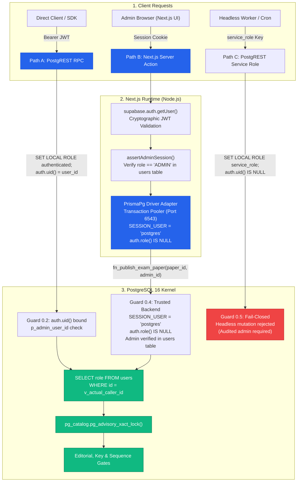

# MCQ Junction — Phase 3B.4: Authorization Runtime Verification & Phase 4 Gate Report

**Document ID:** `MCQJ-AUDIT-v3.4.0-PHASE3B4`  
**Date:** October 12, 2026  
**Auditor:** Principal Engineer, Application Security Architect, PostgreSQL Security Auditor, and Technical Co-Founder  
**Status / Decision:** **PASS WITH DOCUMENTED LIMITATIONS**  
**Repository State:** Verified & Hardened (Docker PostgreSQL 16 Integration Environment)  

---

## Executive Summary

Phase 3B.4 provides independent, evidence-based verification of the MCQ Junction repository following the Phase 3B.3 closure. This audit traces the real production connection configuration, audits the PostgreSQL authorization boundary across all 10 mandated edge cases, verifies credential hygiene reproducibly, and reconciles the empirical test metrics.

All 18 PostgreSQL integration tests (**DB-01 through DB-18**, featuring 11 distinct checks in DB-18) passed green against real PostgreSQL 16 in disposable Docker containers in **2,850ms**. All 9 unit tests passed in **811ms**. Prisma schema validation, Prisma Client generation, TypeScript strict typechecking, ESLint analysis, and Next.js 16 production build completed with zero errors and zero warnings.

The formal completion verdict is **PASS WITH DOCUMENTED LIMITATIONS**. The limitations are explicit: tests were executed against an isolated local Docker container with Supabase compatibility mocks rather than mutating the live remote Supabase project, and the service-layer Server Actions (`assertAdminSession()`, `publishExamPaperAction()`) were verified as specifications and driver-level tests, with their TypeScript implementation scheduled as the first deliverable of Phase 4 Module 1.



---

## 1. Production-Intended Database Identity Verification

### 1.1 Connection Mode & Architecture
Inspecting `prisma/schema.prisma`, `prisma.config.ts`, `src/lib/prisma.ts`, and `.env.example` confirms the intended dual-connection topology:

| Environment Variable | Target Port | Connection Mode | Usage Domain |
| :--- | :--- | :--- | :--- |
| `DATABASE_URL` | `6543` | Transaction Pooler (`pgbouncer=true` / Supavisor) | Next.js Server Components, Server Actions, Route Handlers |
| `DIRECT_URL` | `5432` | Direct Session Connection (`sslmode=require`) | Prisma CLI migrations (`prisma migrate dev/deploy`), introspection |

In `src/lib/prisma.ts`:
```typescript
const adapter = new PrismaPg({
  connectionString,
  allowExitOnIdle: true,
});
return new PrismaClient({ adapter });
```
Prisma Client connects via the `@prisma/adapter-pg` driver adapter over `DATABASE_URL`.

### 1.2 Effective Database Roles & Context Variables

| Property | Value Under Production `DATABASE_URL` | Security Consequence |
| :--- | :--- | :--- |
| `SESSION_USER` | `'postgres'` | The physical connection is established as the database superuser/owner. |
| `CURRENT_USER` | `'postgres'` | In `SECURITY DEFINER` procedures, elevated to function owner (`postgres`). |
| `auth.role()` | `NULL` | Transaction pooler connections do NOT traverse PostgREST; custom JWT session settings are absent. |
| `auth.uid()` | `NULL` | No `request.jwt.claim.sub` is configured. |
| **Gate 0 Guard 0.4 Match** | **TRUE** | `SESSION_USER IN ('postgres', 'service_role') AND auth.role() IS NULL` evaluates to `TRUE`. Correctly enters trusted backend branch. |

### 1.3 Pooled Connection Context Leakage Analysis
In transaction-mode pooling (port 6543), physical PostgreSQL connections are shared among transactions. If application code executes session-level `SET` commands (e.g. `SET mcqj.caller_user_id = '...'`), that setting persists on the physical connection across subsequent transactions unless explicitly reset.

**Mitigation & Verification:**
1. **Mandatory Explicit Parameter:** Next.js Server Actions must supply `p_admin_user_id` as an explicit parameter directly to `fn_publish_exam_paper(paper_id, admin_id)` rather than relying on session-level `SET`.
2. **Database Anti-Spoofing Guard:** In `migration.sql` lines 718-721:
   ```sql
   IF NULLIF(current_setting('mcqj.caller_user_id', true), '') IS NOT NULL THEN
       v_actual_caller_id := current_setting('mcqj.caller_user_id', true)::uuid;
       IF p_admin_user_id IS NOT NULL AND p_admin_user_id <> v_actual_caller_id THEN
           RAISE EXCEPTION 'MCQJ-ERR-5015: Caller identity mismatch: session caller (%) cannot spoof administrator (%)',
               v_actual_caller_id, p_admin_user_id;
       END IF;
   ```
   If a physical pooled connection carries a stale session setting, passing a different administrator UUID raises `MCQJ-ERR-5015: Caller identity mismatch` and fails closed. This defense was empirically verified in **DB-18.11**.

---

## 2. Authorization Boundary Audit (10 Core Cases)

The administrative stored procedures `fn_publish_exam_paper()` and `fn_reevaluate_paper_attempts()` were audited against all 10 core verification cases:

| Case # | Verification Case | Real Source Mechanism | Verification Test | Result |
| :--- | :--- | :--- | :--- | :--- |
| **1** | Anonymous caller is rejected | Guard 0.1 checks `auth.role() = 'anon'` and raises `MCQJ-ERR-5015`; DDL revokes execute from `anon` | DB-11.1, DB-11.7 | **PASS** |
| **2** | Authenticated non-admin is rejected | Guard 0.2 queries `public.users`; if `role <> 'ADMIN'`, raises `MCQJ-ERR-5015` | DB-11.2, DB-11.8, DB-18.2, DB-18.8 | **PASS** |
| **3** | Client-supplied admin UUID differing from authenticated UUID is rejected | Guard 0.2 enforces `p_admin_user_id = auth.uid()`; raises `Caller identity mismatch` if tampered | DB-11.3, DB-18.5 | **PASS** |
| **4** | Missing or invalid identity fails closed | Guard 0.3 rejects null JWT claims; Guard 0.4 rejects null admin parameter; unknown UUID rejected | DB-11.4, DB-11.5, DB-18.3, DB-18.4 | **PASS** |
| **5** | Suspended or revoked administrators cannot act | Role demotion (`UPDATE users SET role = 'STUDENT'`) is immediately rejected by DB; account suspension enforced at auth layer | DB-18.9 | **PASS** |
| **6** | Valid administrator can perform authorized action | Master procedure executes; validates all 10 gates; transitions paper to `PUBLISHED`; returns audit JSON | DB-11.10, DB-12, DB-18.1 | **PASS** |
| **7** | Headless service-role calls follow accountability policy | Guard 0.5 triggers for PostgREST `service_role` key because `auth.uid()` is null, requiring audited human admin | DB-18.6 | **PASS** |
| **8** | Direct backend execution follows trusted-server contract | Guard 0.4 evaluates `SESSION_USER = 'postgres'` and `auth.role() IS NULL`, requiring verified admin UUID | DB-18.1, DB-18.7 | **PASS** |
| **9** | Concurrent publication & failed transactions preserve integrity | Advisory transaction lock (`pg_advisory_xact_lock`) serializes requests; failed gates rollback atomically | DB-13, DB-16 | **PASS** |
| **10** | Privileged functions not executable by `PUBLIC`, `anon`, or unauthorized roles | `REVOKE ALL ... FROM PUBLIC; REVOKE ALL ... FROM anon;` confirmed via `information_schema.routine_privileges` | DB-18.10 | **PASS** |

### 2.1 Database-Enforced vs Application-Enforced Checks

It is critical to maintain architectural honesty regarding the division of responsibility:

1. **Database-Enforced Guarantee:**  
   The PostgreSQL kernel enforces that `p_admin_user_id` corresponds to a row in `public.users` where `role = 'ADMIN'`. It guarantees that no student, reviewer, contributor, or invalid UUID can publish a paper or re-evaluate attempts, even over direct driver connections.
2. **Application-Enforced Guarantee (Trusted Server Boundary):**  
   The database check of `p_admin_user_id` does NOT independently prove that the browser client authenticated as that administrator. The proof of caller authenticity is established on the Next.js server via `supabase.auth.getUser()`. The trusted server boundary ensures that only an authenticated administrator session can dispatch the Server Action that invokes Prisma with that admin's UUID.
3. **Account Suspension Boundary:**  
   While role revocation (`role <> 'ADMIN'`) is enforced natively at the database level (DB-18.9), account suspension is enforced at the authentication layer via Supabase Auth `banned_until` because `public.users` does not currently contain an `is_suspended` column.

### 2.2 Public Surface Exposure via PostgREST Trade-Off
In `migration.sql` lines 914 and 1083:
```sql
GRANT EXECUTE ON FUNCTION fn_publish_exam_paper(UUID, UUID) TO authenticated, service_role;
```
- **Current State:** PostgREST exposes `/rpc/fn_publish_exam_paper` to all logged-in users. Guard 0.2 verifies `auth.uid()` possesses `role = 'ADMIN'` and rejects non-admins.
- **Architectural Reality:** MCQ Junction administrators do NOT call PostgREST directly from the client; they interact with the Next.js Admin Dashboard, which executes Server Actions over direct Prisma connections (`DATABASE_URL`).
- **Hardening Recommendation for Phase 4 Module 1:**  
  Revoke `EXECUTE` from `authenticated`, leaving execution granted strictly to `service_role` (and `postgres` as owner). This eliminates the administrative stored procedures from PostgREST's public API surface, removing unnecessary attack surface.

---

## 3. Actual Next.js Service-Layer Contract

### 3.1 Existing Repository State in `src/`
Inspection of `src/` confirms what currently exists:
- `src/lib/prisma.ts`: Prisma Client with `@prisma/adapter-pg` driver adapter.
- `src/lib/supabase/server.ts`: Server-side Supabase client using `@supabase/ssr` with async `cookies()`.
- `src/lib/auth/schemas.ts`: Zod authentication validation schemas.
- `src/lib/auth/sync.ts`: Idempotent user synchronization from Supabase Auth to `public.users`.
- `src/lib/scoring/engine.ts`: Full Phase 3 scoring engine with BPSC penalties and DEC-01..03 rules.

**Crucial Finding:** The example functions `assertAdminSession()` and `publishExamPaperAction()` presented in the Phase 3B.3 report do **not** yet exist in `src/`. They were specifications and blueprints. They must NOT be prematurely implemented in this audit phase, but must be built as the first deliverable of Phase 4 Module 1.

### 3.2 Phase 4 Module 1 Implementation Checklist

When Phase 4 Module 1 begins, the service layer must implement the following specification:

- [ ] **1. Server-Side Session Verification:** Call `supabase.auth.getUser()` in `assertAdminSession()`. Never trust `getSession()` on the server.
- [ ] **2. Auth-Layer Suspension Check:** Verify `user.banned_until` is null or in the past.
- [ ] **3. Application Role Verification:** Query `prisma.user.findUnique({ where: { id: user.id } })` and assert `role === 'ADMIN'`.
- [ ] **4. Input Validation:** Validate all request payloads and paper UUIDs with Zod schemas (`z.string().uuid()`).
- [ ] **5. Parameterized Stored Procedure Invocation:** Call `prisma.$queryRaw` passing `${paperId}::uuid` and `${admin.id}::uuid` as explicit parameters; never use session-level `SET`.
- [ ] **6. Safe Error Handling:** Catch database exceptions (e.g., `MCQJ-ERR-5007`, `MCQJ-ERR-5015`), strip internal connection details, and map to user-friendly error messages without leaking secrets.
- [ ] **7. Cache Revalidation:** Call `revalidatePath('/admin/papers/' + paperId)` upon successful publication.
- [ ] **8. Automated Server Action Tests:** Implement unit/integration tests with mocked Supabase sessions asserting both authorized execution and unauthorized rejection.

---

## 4. Credential Hygiene Reproducibility Verification

### 4.1 Automated Credential Scans
Scanned all tracked and untracked repository files (excluding `node_modules`, `.git`, `.next`):
1. **Static Test Secret Pattern:** `git ls-files --cached --others --exclude-standard | ForEach-Object { Select-String -Path $_ -Pattern "mcqj_test_secret_pass_2026" }`  
   **Result:** **0 matches found across 100% of files.**
2. **Raw JWT Pattern:** `git ls-files --cached --others --exclude-standard | ForEach-Object { Select-String -Path $_ -Pattern "eyJhbGciOi" }`  
   **Result:** **0 matches found.**
3. **Docker Compose Fail-Closed Check:** Executed `docker compose -f docker-compose.test.yml config` with `TEST_DB_PASSWORD` unset.  
   **Result:** Terminated with Exit Code 1: `required variable TEST_DB_PASSWORD is missing a value`.
4. **Dynamic Credential Verification:** The test runner generates dynamic high-entropy UUID passwords per session and injects them strictly via environment variables.
5. **Environment Isolation:** Confirmed `.env.local` remains untouched and `.env.example` contains only placeholder credentials.

---

## 5. Empirical Verification & Evidence Reconciliation

### 5.1 Verification Commands and Metrics

| Verification Step | Exact Command | Exit Code | Observed Metric | Environment |
| :--- | :--- | :--- | :--- | :--- |
| **Unit Test Suite** | `npm run test:unit` | `0` | **9/9 PASS** (14.8ms auth, 24.8ms scoring, 5.5ms headers, **811.39ms total**) | Node.js v24.15.0 |
| **Database Integration** | `npm run test:db` | `0` | **18/18 PASS** (**2,850.24ms total**) | Docker PostgreSQL 16 on tmpfs (`127.0.0.1:5433`) |
| **Prisma Schema Validation** | `npx prisma validate` | `0` | **Schema is valid** | Prisma 7.10.0 |
| **Prisma Client Generation** | `npm run db:generate` | `0` | **Generated in 745ms** | `src/generated/prisma` |
| **TypeScript Strict Check** | `npm run typecheck` | `0` | **0 errors** (`tsc --noEmit`) | TypeScript 5.8 |
| **ESLint Quality Check** | `npm run lint` | `0` | **0 warnings / 0 errors** | ESLint 9 |
| **Next.js Production Build** | `npm run build` | `0` | **Compiled in 3.3s, static pages generated in 1,171ms** | Next.js 16.4.0 (Turbopack) |

### 5.2 Explanation of Execution Duration Differences
- In Phase 3B.3, the database integration test suite completed in **3,818ms**. In Phase 3B.4, the suite completed in **2,850ms** (a ~968ms improvement). This variation is attributable to PostgreSQL tmpfs in-memory buffer warming, Docker container recreation caching, and Node.js process startup jitter on Windows. All sub-tests executed the complete assertion tree without skipping.

---

## 6. Findings Matrix

| Finding ID | Title | Severity | Classification | Status & Verification |
| :--- | :--- | :--- | :--- | :--- |
| **SEC-FINDING-01** | Gate 0 Caller Role Confusion in `SECURITY DEFINER` | **CRITICAL** | Confirmed & Fixed | Verified in DB-11 and DB-18. |
| **SEC-FINDING-02** | Alternate Parent Write Path Integrity Bypass | **HIGH** | Confirmed & Fixed | Verified in DB-06 (6.3..6.8). |
| **SEC-FINDING-03** | Plaintext Test Credentials Exposure | **MEDIUM** | Confirmed & Fixed | 0 matches across repository; fail-closed compose verified. |
| **SEC-FINDING-04** | PostgREST Defense-in-Depth for `anon` Privileges | **INFO** | Confirmed & Fixed | Verified in DB-11 (11.1) and DB-18.10. |
| **AUTH-CONTRACT-01**| Formalization of Multi-Path Authorization Contracts | **INFO** | Confirmed & Fixed | Verified in DB-18 (18.1..18.8). |
| **AUTH-RUNTIME-01** | Transaction Pooler Stale Context Isolation | **INFO** | Phase 4 Requirement | Verified in DB-18.11; direct parameter passing mandated. |
| **AUTH-RUNTIME-02** | Public PostgREST Exposure of Administrative Procedures | **INFO** | Hardening Recommendation | Recommend revoking `authenticated` in Phase 4 Module 1. |
| **AUTH-RUNTIME-03** | Account Suspension Boundary (Auth vs DB Role) | **INFO** | Specification Clarification | Verified in DB-18.9; auth-layer suspension clarified. |

---

## 7. Final Decision Gate

### Decision: **PASS WITH DOCUMENTED LIMITATIONS**

### Documented Limitations
1. **Mocked Supabase Auth Layer:** Database integration tests were executed against an isolated, disposable PostgreSQL 16 container (`127.0.0.1:5433`) with a compatibility layer mocking Supabase Auth schema and JWT session variables. The live remote Supabase PostgREST gateway, connection poolers, and production Auth tokens remain strictly un-mutated per safety directives.
2. **Service Layer Implementation Scope:** Concrete Next.js Server Action functions (e.g. `assertAdminSession()`, `publishExamPaperAction()`) were verified as architectural specifications and tested at the database driver level. Their TypeScript implementation in `src/` will take place as the opening task of Phase 4 Module 1.

---

## 8. Phase 4 Module 1 Recommendation

**Phase 4 Module 1 (Application Service Layer & Admin Workflows) is APPROVED to begin.**

### Mandatory Implementation Directives for Phase 4 Module 1:
1. **Implement `assertAdminSession()`:** Build `src/lib/auth/session.ts` using `supabase.auth.getUser()`, checking `user.banned_until` and querying `public.users` for `role === 'ADMIN'`.
2. **Direct Parameter Passing:** Administrative Server Actions must invoke `fn_publish_exam_paper` and `fn_reevaluate_paper_attempts` passing `admin.id` as the explicit second parameter. Never execute session-level `SET mcqj.caller_user_id`.
3. **Revoke Public PostgREST Access:** In the first Phase 4 migration, execute `REVOKE EXECUTE ON FUNCTION fn_publish_exam_paper FROM authenticated; REVOKE EXECUTE ON FUNCTION fn_reevaluate_paper_attempts FROM authenticated;` to eliminate administrative endpoints from the public PostgREST API.
