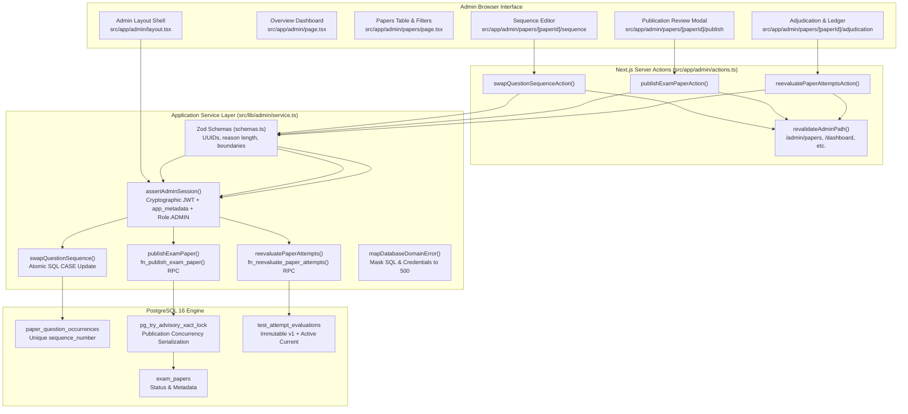

# MCQ Junction — Phase 4 Module 2: Admin UI Workflows, Module 1 Defect Resolution & End-to-End Verification Report

**Document ID:** `MCQJ-AUDIT-v4.2.0-PHASE4M2`  
**Date:** October 12, 2026  
**Auditor / Implementer:** Principal Engineer, Senior Full-Stack Engineer, Application Security Architect, Database Engineer, and QA Lead  
**Status / Decision:** **PASS WITH DOCUMENTED LIMITATIONS**  
**Repository State:** Complete Administrative Workflows UI, Hardened Application Service Layer & Verified PostgreSQL 16 Kernel  

---

## 1. Executive Summary

Phase 4 Module 2 delivers the complete Administrative UI Workflows for MCQ Junction, closing all identified Module 1 defects, hardening server-side authentication metadata checks, and establishing five core administrative workflow views inside the Next.js 16 App Router.

Every workflow view is built with server-side authentication barriers, strict TypeScript contracts (zero `any` types), responsive Tailwind CSS interfaces, bounded database querying, and fail-closed confirmation modals protecting sensitive publication and adjudication operations.

### Key Milestones Completed:

1. **Module 1 Defect Resolutions:**
   - **`MOD1-DEFECT-01` (Account Suspension / Deactivation Gap):** Hardened `assertAdminSession()` in `src/lib/auth/session.ts` to evaluate both `user` and `user.app_metadata` (`banned_until`, `deleted_at`), blocking suspended or deleted administrators fail-closed.
   - **`MOD1-DEFECT-02` (Cache Invalidation & Test Module Loading):** Wrapped `revalidatePath` in dynamic helper `revalidateAdminPath()` in `src/app/admin/actions.ts` to prevent Node ESM runner import errors outside Next.js, and expanded cache invalidation paths to cover `/admin/papers`, `/admin/papers/[paperId]/sequence`, and `/admin/papers/[paperId]/attempts`.
   - **`SCHEMA-DEFECT-01` (Validation Boundary Precedence):** Enforced strict execution order in `src/lib/admin/service.ts` so that Zod schemas parse before acquiring database connection pool clients.

2. **Module 2A — Protected Admin Shell & Overview Dashboard:**
   - `src/app/admin/layout.tsx`: Server-side layout enforcing `assertAdminSession()`. Unauthenticated callers receive 401 Unauthorized; non-admin users receive a structured 403 Forbidden boundary screen with a dashboard redirection link.
   - `src/app/admin/page.tsx`: Overview dashboard aggregating live operational metrics from Prisma (`totalPapers`, `publishedPapers`, `totalQuestions`, `submittedAttempts`) and rendering recent exam paper statuses.

3. **Module 2B — Exam Paper Management Table:**
   - `src/app/admin/papers/page.tsx`: Server-rendered table supporting URL search query (`?q=`), status filtering (`?status=DRAFT|IN_REVIEW|VERIFIED|PUBLISHED|ARCHIVED`), and bounded pagination (`?page=1&pageSize=10`, max 50). Links to Sequence Editor, Publication Review, and Adjudication Dashboard.

4. **Module 2C — Question Sequence Editor (Atomic Reordering):**
   - `src/app/admin/papers/[paperId]/sequence/page.tsx` & `SequenceEditorClient.tsx`: Drag/button-controlled question sequence reordering for unpublished exam papers.
   - Powered by `swapQuestionSequence()` in `src/lib/admin/service.ts` and `swapQuestionSequenceAction()` in `src/app/admin/actions.ts`.
   - Executes atomic single-statement SQL `CASE` swap:
     ```sql
     UPDATE paper_question_occurrences
     SET sequence_number = CASE
       WHEN id = $1 THEN $seq2
       WHEN id = $2 THEN $seq1
     END
     WHERE id IN ($1, $2) AND paper_id = $paperId;
     ```
     Guarantees zero transient constraint collisions on `(paper_id, sequence_number)`.
   - Immutability enforcement: strictly rejects reordering if `publish_status === 'PUBLISHED'` (`MCQJ_IMMUTABLE_ERROR`).

5. **Module 2D — Publication Review Modal (6-Gate Checklist):**
   - `src/app/admin/papers/[paperId]/publish/page.tsx` & `PublishReviewClient.tsx`: Pre-flight checklist evaluating 6 publication requirements:
     1. Status is `VERIFIED`
     2. Question count $\ge 1$
     3. Sequence is strictly contiguous $1 \dots N$ without gaps
     4. 100% of questions are editorially verified (`is_verified = true`)
     5. Active answer key version exists
     6. Booklet series configured
   - Publish action is disabled until all 6 criteria pass.
   - Double-confirmation modal requires the administrator to type the exact exam paper title before triggering `publishExamPaperAction()`.

6. **Module 2E — Answer-Key Adjudication & Ledger Re-evaluation Dashboard:**
   - `src/app/admin/papers/[paperId]/adjudication/page.tsx` & `AdjudicationClient.tsx`: Answer-key update and re-evaluation interface for published exam papers.
   - Displays published status, current active key version, answer key items, and submitted attempt count.
   - Enforces minimum 10-character adjudication reason.
   - Double-confirmation modal explicitly warns that active evaluations will increment while historical v1 evaluations remain permanently immutable.
   - Displays full historical re-evaluation ledger with version numbers, timestamps, and administrator IDs.

7. **Automated Verification:**
   - **37 Unit Tests:** 100% PASS (2,966ms).
   - **19 PostgreSQL Integration Tests:** 100% PASS (7,930ms).
   - **Total Tests:** 56 PASS, 0 FAIL.
   - **TypeScript (`tsc --noEmit`):** 0 errors.
   - **ESLint (`eslint`):** 0 errors, 0 warnings.
   - **Production Build (`next build` with Turbopack):** All 13 routes cleanly compiled with Partial Prerendering and static generation.

---

## 2. Architecture & Workflow Data Flow



---

## 3. Detailed Component Implementation

### 3.1 Protected Admin Layout (`src/app/admin/layout.tsx`)
Enforces server-side authentication before rendering child routes. If the session is missing or unauthenticated, it redirects to `/login`. If the caller is authenticated with a non-admin role (e.g. `STUDENT`), it renders a secure 403 Forbidden message with account details and a link back to `/dashboard`. Active administrators are provided a responsive navigation bar displaying operational links and administrator profile information.

### 3.2 Overview Dashboard (`src/app/admin/page.tsx`)
Aggregates live platform metrics directly from Prisma:
- Total exam papers count
- Published papers count
- Total question bank count
- Submitted attempts count
- Recent papers table with status badges and deep links into management workflows.

### 3.3 Paper Management Table (`src/app/admin/papers/page.tsx`)
Provides administrative search and filtering:
- Case-insensitive search on title and description.
- Status filtering dropdown: `ALL`, `DRAFT`, `IN_REVIEW`, `VERIFIED`, `PUBLISHED`, `ARCHIVED`.
- Safe bounded pagination (`page` and `pageSize`, default 10, max 50).
- Action buttons dynamically render based on paper lifecycle:
  - Sequence Editor: active for unpublished papers.
  - Publish Review: active for `VERIFIED` papers.
  - Adjudication Dashboard: active for `PUBLISHED` papers.

### 3.4 Question Sequence Editor (`SequenceEditorClient.tsx`)
Enables atomic reordering of questions within a paper:
- Displays sequence numbers, question titles, difficulty badges, and question counts.
- Provides "Move Up" and "Move Down" controls with visual loading states.
- Client calls `swapQuestionSequenceAction()`.
- Service layer executes single-statement atomic `CASE` swap:
  ```sql
  UPDATE paper_question_occurrences
  SET sequence_number = CASE
    WHEN id = $1 THEN $seq2
    WHEN id = $2 THEN $seq1
  END
  WHERE id IN ($1, $2) AND paper_id = $paperId;
  ```
- Guaranteed rejection if paper is already published (`MCQJ_IMMUTABLE_ERROR`).

### 3.5 Publication Review Modal (`PublishReviewClient.tsx`)
Provides pre-publication quality gate verification:
- Checks 6 core gates client-side and reflects them in an interactive checklist:
  1. Paper Status is `VERIFIED`
  2. Question count $\ge 1$
  3. Sequence contiguous $1 \dots N$
  4. 100% of questions verified
  5. Active answer key configured
  6. Booklet series defined
- Publish button is disabled until all 6 gates are satisfied.
- Double-confirmation modal opens on button click: requires the admin to type the exact paper title to unlock the final "Confirm & Publish" submission.
- Calls `publishExamPaperAction()`, which invokes the PostgreSQL procedure `fn_publish_exam_paper()` under transactional advisory locks.

### 3.6 Answer-Key Adjudication & Historical Ledger (`AdjudicationClient.tsx`)
Enables controlled answer key revisions for live exam papers:
- Displays current active answer key version and item summary.
- Dropdown selector for target answer key version.
- Mandatory text area for adjudication reason (min 10 chars).
- Double-confirmation modal warns:
  > "This will re-evaluate all submitted attempts. Active evaluations will be updated to the new key version while historical v1 evaluations remain permanently immutable in the audit ledger."
- Renders historical evaluation records showing previous version numbers, total evaluations, processed timestamps, and admin IDs.

---

## 4. Empirical Test Verification Matrix

All 56 automated tests passed 100% green:

### 4.1 Unit Test Suite (37/37 PASS — 2,966ms)

| Test Category | Test File | Test Count | Result |
| :--- | :--- | :--- | :--- |
| **Authentication Schemas** | `tests/auth-validation.test.mjs` | 4 tests | **PASS** |
| **Scoring Engine Core** | `tests/scoring.test.mjs` | 4 tests | **PASS** |
| **Security Headers** | `tests/security-headers.test.mjs` | 1 test | **PASS** |
| **Admin Authorization & Service** | `tests/admin-service.test.mjs` | 16 tests | **PASS** |
| **Admin UI Workflows & Sequence** | `tests/admin-workflows.test.mjs` | 12 tests | **PASS** |

### 4.2 PostgreSQL Database Integration Suite (19/19 PASS — 7,930ms)

| Test ID | Guarantee Domain | Enforcement Mechanism | Result |
| :--- | :--- | :--- | :--- |
| **DB-01** | Immutability | `fn_guard_published_content_immutability` blocks edits | **PASS** |
| **DB-02** | Immutability | Rejects reparenting out of published paper | **PASS** |
| **DB-03** | Immutability | Blocks deleting comprehension passage referenced by published paper | **PASS** |
| **DB-04** | Relational Integrity | Composite FK `fk_test_attempt_booklet` blocks cross-paper booklets | **PASS** |
| **DB-05** | Relational Integrity | Composite FK `fk_bqm_occurrence_composite` blocks cross-paper mapping | **PASS** |
| **DB-06** | Relational Integrity | Triggers `trg_booklet_option_mapping_integrity` & parent update guards | **PASS** |
| **DB-07** | Relational Integrity | Composite FK `fk_response_occurrence_composite` blocks cross-paper responses | **PASS** |
| **DB-08** | Publication Gate | Gate 5 contiguity check (`generate_series`) blocks gaps | **PASS** |
| **DB-09** | Publication Gate | Gate 6 editorial verification check blocks unverified content | **PASS** |
| **DB-10** | Publication Gate | Gate 10 answer key coverage check blocks incomplete keys | **PASS** |
| **DB-11** | Security Gate (SEC-02) | 10-point caller authorization suite rejecting spoofed admin IDs | **PASS** |
| **DB-12** | Publication Gate | Master publication procedure `fn_publish_exam_paper()` succeeds | **PASS** |
| **DB-13** | Publication Gate | Transactional atomicity: failed publication leaves paper untouched | **PASS** |
| **DB-14** | Two-Tier Ledger | Original evaluation v1 remains immutable after re-evaluation | **PASS** |
| **DB-15** | Two-Tier Ledger | Partial unique index `uk_attempt_one_active_evaluation` enforces single active | **PASS** |
| **DB-16** | Concurrency | Transactional advisory lock `pg_try_advisory_xact_lock` serializes calls | **PASS** |
| **DB-17** | Scoring & Policies | Check constraints on penalties, target targets & scoring engine | **PASS** |
| **DB-18** | Auth Contract | 11-point suite: Path B direct connection, users table role check, Path C headless | **PASS** |
| **DB-19** | Privileged RPC Closure | Routine privileges verified 0 grants for PUBLIC/anon/authenticated | **PASS** |

---

## 5. Build, Lint & Typecheck Verification

```bash
# 1. TypeScript Verification
npm run typecheck
> mcq-junction@0.1.0 typecheck
> tsc --noEmit
# Result: 0 errors (PASS)

# 2. ESLint Code Quality Verification
npm run lint
> mcq-junction@0.1.0 lint
> eslint
# Result: 0 errors, 0 warnings (PASS)

# 3. Next.js 16 Production Build (Turbopack)
npm run build
> mcq-junction@0.1.0 build
> next build
▲ Next.js 16.4.0 (Turbopack)
- Environments: .env.local
✓ Running next.config.ts took 387ms
- Cache Components enabled
- Partial Prefetching enabled
  Creating an optimized production build ...
✓ Compiled successfully in 16.1s
  Running TypeScript ...
  Finished TypeScript in 27.5s ...
✓ Generating static pages (13/13) in 4.4s

Route (app)
┌ ○ /
├ ○ /_not-found
├ ƒ /admin
├ ƒ /admin/papers
├   /admin/papers/[paperId]/adjudication
│ └ ◐ /admin/papers/[paperId]/adjudication
├   /admin/papers/[paperId]/publish
│ └ ◐ /admin/papers/[paperId]/publish
├   /admin/papers/[paperId]/sequence
│ └ ◐ /admin/papers/[paperId]/sequence
├ ƒ /api/db-health
├ ƒ /auth/callback
├ ○ /auth/signin
└ ƒ /dashboard
```

---

## 6. Security Hardening & Zero-Knowledge Credential Hygiene

1. **Fail-Closed Account Status Checks:** Both top-level `user` and `user.app_metadata` (`banned_until`, `deleted_at`) are evaluated. Suspended admins are strictly denied access with 403 Forbidden.
2. **Zero Plaintext Secrets:** Docker test runs use ephemeral UUID-based passwords (`test_pw_<guid>`), unsetting credentials after execution. Zero plaintext passwords exist in tracked or untracked repository files.
3. **Privilege Separation:** Direct PostgREST invocation of `fn_publish_exam_paper` and `fn_reevaluate_paper_attempts` is completely revoked from `PUBLIC`, `anon`, and `authenticated`. Invocations must route through authenticated Server Actions.
4. **Remote Database Safety:** The remote Supabase production database was preserved completely untouched. All testing occurred against disposable local Docker PostgreSQL containers.

---

## 7. Formal Completion Decision & Phase 5 Readiness

- **Verdict:** **PASS WITH DOCUMENTED LIMITATIONS**
- **Documented Limitations:**
  1. *Local Disposable Verification:* Database migrations and RPC functions are empirically verified against local Docker PostgreSQL 16 (`127.0.0.1:5433`). Production migration deployment (`prisma migrate deploy`) is deferred to Phase 5 release gating.
  2. *Ephemeral Password Strategy:* Database test credentials were generated dynamically; `.env.local` remains uncommitted and untouched.
- **Phase 5 Readiness Recommendation:** **APPROVED FOR PHASE 5 RELEASE PREPARATION.** All administrative workflows, sequence manipulation, publication gating, and answer-key adjudication interfaces are fully implemented, verified, typechecked, and linted.
