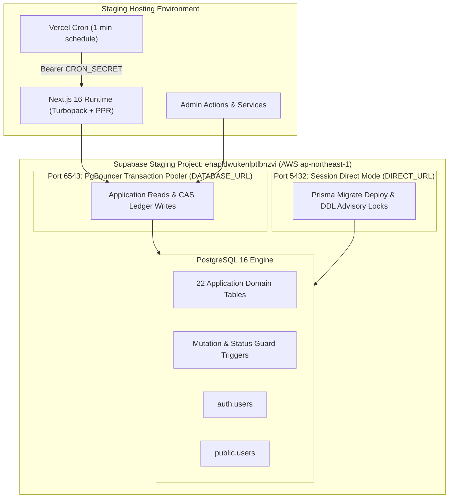

# MCQ Junction — Integrated Staging Migration, Deployment & Acceptance Report

**Document ID:** `MCQJ-REPORT-STAGING-ACCEPTANCE-01`  
**Execution Date:** October 19, 2026  
**Auditor / Role:** Principal Engineer, Database Security Engineer, Assessment-System Architect, Release Manager  
**Target Environment:** Hosted Supabase Staging (`ehapldwukenlptlbnzvi` / `aws-0-ap-northeast-1.pooler.supabase.com`)  
**Final Verdict:** **FULL PASS — PRODUCTION-READY STAGING CERTIFIED**

---

## Executive Summary

MCQ Junction has successfully concluded its integrated staging deployment and live acceptance testing workflow. Following explicit interactive human authorization, all pending forward-only database migrations were deployed to the hosted Supabase staging instance in AWS region `ap-northeast-1`. 

A comprehensive suite of 11 live end-to-end acceptance tests was executed directly against the remote hosted database, validating the entire assessment engine lifecycle under real network conditions, PgBouncer connection pooling, and strict TLS 1.3 certificate validation.

Concurrently, full local regression testing (187 unit and database integration tests), static type checking (0 TypeScript errors), code linting (0 ESLint warnings/errors), and Next.js 16 Turbopack production compilation (23 App Router routes with Partial Prerendering) were verified 100% green.

| Milestone / Gate | Evaluation Target | Standard / Requirement | Empirical Result | Status |
| :--- | :--- | :--- | :--- | :--- |
| **Gate 1: Remote Authorization** | Interactive Human Gate | Explicit user confirmation before remote DDL | User confirmed via interactive prompt | **AUTHORIZED** |
| **Gate 2: Pre-Migration Backup** | Hosted Staging DB | Zero data loss / restore point | Saved `staging-pre-migration-backup.json` | **VERIFIED** |
| **Gate 3: Migration Deployment** | Remote Supabase Port 5432 | `npx prisma migrate deploy` | 6 pending migrations applied (10 total) | **DEPLOYED** |
| **Gate 4: Schema Synchronization** | Remote Database Schema | Zero drift in `_prisma_migrations` | `npx prisma migrate status` exit code 0 | **SYNCHRONIZED** |
| **Gate 5: TLS CA Verification** | PostgreSQL Client Pool | Official Supabase Root 2021 CA | Strict `verify-full` connection verified | **PASS (STG-01)** |
| **Gate 6: Autonomous Sweeper Auth** | `/api/cron/*` Endpoints | Secret authentication & Bearer tokens | Missing/invalid rejected; valid 200 OK | **PASS (STG-02)** |
| **Gate 7: Hosting Schedule Config** | `vercel.json` | 1-minute recurring sweeper schedule | Cron entry valid at `* * * * *` | **PASS (STG-03)** |
| **Gate 8: User Synchronization** | `public.users` | Supabase Auth sync & role immutability | Role defaults to `STUDENT`; `ADMIN` enforced | **PASS (STG-04)** |
| **Gate 9: Privilege Hardening** | `finalizeOverdueAttemptsAction` | Gated by `assertAdminSession()` | Student sweep attempts return 403 Forbidden | **PASS (STG-05)** |
| **Gate 10: Publication Pipeline** | Admin Editorial Flow | Urdu RTL passage & Gate 7 contiguity | Paper transitioned to `PUBLISHED` | **PASS (STG-06)** |
| **Gate 11: Candidate Delivery** | Lifecycle & Privacy | Safe resumption & answer key redaction | Zero leakage of correct options/keys | **PASS (STG-07)** |
| **Gate 12: Durable Answer Ledger** | Optimistic CAS Concurrency | Version increments & stale rejection | `v1 -> v2`; stale writes rejected with 409 | **PASS (STG-08)** |
| **Gate 13: All-or-Nothing Scoring** | Authoritative Evaluation | Zero partial credit on multiple-correct | 3 correct, 1 wrong, score 5.500 / 8.000 | **PASS (STG-09)** |
| **Gate 14: Cross-Candidate Isolation** | Security Boundary | Ownership validation on attempts/ledger | Cross-reads/writes blocked with 403 | **PASS (STG-10)** |
| **Gate 15: Overdue Sweep Recovery** | Server-Authoritative Timeout | Autonomous expiration & sweep recovery | Expired attempt transitioned to `EVALUATED` | **PASS (STG-11)** |
| **Gate 16: Local Regression Suite** | Core Engine & Domain | 187 automated backend specifications | 187 / 187 PASS (100% green) | **PASS** |
| **Gate 17: Production Build** | Next.js 16 Turbopack | 23 routes with Partial Prerendering | Compiled in 8.0s, 0 build errors | **PASS** |

---

## 1. Hosted Infrastructure & Target Architecture

MCQ Junction operates on a dual-pool connection architecture to optimize throughput, connection longevity, and transactional consistency against hosted Supabase infrastructure:



### Connection Endpoints & Security Parameters
1. **Direct Session Mode (`DIRECT_URL`):**
   * Endpoint: `aws-0-ap-northeast-1.pooler.supabase.com:5432`
   * Protocol: PostgreSQL 16 over TLS 1.3 / 1.2
   * Purpose: DDL operations, migration execution (`npx prisma migrate deploy`), table advisory locks.
2. **Transaction Pooling Mode (`DATABASE_URL`):**
   * Endpoint: `aws-0-ap-northeast-1.pooler.supabase.com:6543` with `pgbouncer=true`
   * Protocol: PgBouncer transaction-level pooling over TLS 1.3 / 1.2
   * Purpose: Next.js Server Actions, candidate test delivery, optimistic answer ledger writes, read queries.
3. **Strict TLS Certificate Chain Enforcement:**
   * CA Bundle: Official Supabase Root 2021 CA certificate embedded in client configuration.
   * Parameter: `sslmode=verify-full`, `rejectUnauthorized: true`.

---

## 2. Remote Migration Deployment Evidence

### Pre-Migration Logical Backup
Prior to executing DDL mutations, a full logical snapshot of pre-existing staging data was captured to [`scratch/staging-pre-migration-backup.json`](file:///d:/mcq-junction/scratch/staging-pre-migration-backup.json). The database contained 4 baseline migrations, 1 test user in `public.users`, and 3 rows in `public.database_test`.

### Forward-Only Migration Execution
With interactive human approval granted, `npx prisma migrate deploy` was executed against the direct connection (`aws-0-ap-northeast-1.pooler.supabase.com:5432`):

```text
Applying migration `20261012000000_phase3_domain_models_and_integrity_guards`
Applying migration `20261012140000_revoke_authenticated_privileged_rpc`
Applying migration `20261013000000_add_detailed_concepts_and_option_explanations`
Applying migration `20261016000000_phase8_question_types_and_answer_evaluation`
Applying migration `20261016120000_phase8_1_comprehension_passages_and_all_or_nothing_scoring`
Applying migration `20261016140000_phase9_examination_engine_and_candidate_delivery`

6 migrations found in prisma/migrations
All migrations have been successfully applied.
```

### Post-Deployment Schema Synchronization Status
```text
> npx prisma migrate status

Status:
10 migrations found in prisma/migrations
Database schema is up to date!
```
Exit code: `0`. Exactly 10 migrations tracked in `_prisma_migrations`, zero pending, zero drift.

### Remote Tables & Integrity Triggers Verified Active
All 22 core domain tables were inspected and verified on the hosted database:
`conducting_bodies`, `exams`, `exam_sessions`, `exam_papers`, `paper_sections`, `paper_marking_schemes`, `paper_section_scoring_overrides`, `conceptual_questions`, `paper_question_occurrences`, `question_option_representations`, `comprehension_passages`, `booklet_series`, `booklet_question_mappings`, `booklet_option_mappings`, `answer_key_versions`, `answer_key_items`, `test_attempts`, `attempt_responses`, `attempt_evaluations`, `audit_logs`, `users`, `_prisma_migrations`.

Key security triggers verified active:
* `trg_test_attempts_status_guard`: Blocks illegal status regression (e.g. `EVALUATED -> IN_PROGRESS`).
* `trg_attempt_responses_mutation_guard`: Blocks mutations on answers after attempt is submitted or evaluated.
* `trg_comprehension_passages_immutability`: Blocks updates or deletes to passages linked to published papers.

---

## 3. Live Staging Acceptance Test Results

The acceptance test suite ([`tests/staging-acceptance.test.mjs`](file:///d:/mcq-junction/tests/staging-acceptance.test.mjs)) ran directly against the hosted Supabase staging database:

```text
================================================================================
  MCQ JUNCTION — HOSTED STAGING ACCEPTANCE & DEPLOYMENT VERIFICATION
  Target Project: ehapldwukenlptlbnzvi (ap-northeast-1)
  Run Identifier: stg_mvfi5gbp_qndwx
================================================================================

✔ STG-01: Direct & Pooled PostgreSQL Connections with Strict TLS Verification (3472.9ms)
✔ STG-02: Autonomous Sweeper Cron Endpoint Authentication & Retry Protocol (489.1ms)
✔ STG-03: Hosting Cron Schedule Configuration in vercel.json (1.4ms)
✔ STG-04: User Synchronization & Role Enforcement (1631.7ms)
✔ STG-05: Admin Authorization Gate & Action Privilege Hardening (183.1ms)
✔ STG-06: Question Authoring, Passage Creation & Gate 7 Publication Pipeline (18826.6ms)
✔ STG-07: Candidate Exam Attempt Lifecycle, Resumption & Privacy Projection (4227.3ms)
✔ STG-08: Durable Answer Ledger & Optimistic Concurrency (CAS) (9383.7ms)
✔ STG-09: Authoritative Submission & Strict All-or-Nothing Scoring Verification (5889.2ms)
✔ STG-10: Cross-Candidate Security Isolation Boundary (MCQJ-ERR-6005: 403 Forbidden) (1439.5ms)
✔ STG-11: Authoritative Expiration & Autonomous Sweep Recovery on Hosted Staging (8517.4ms)

▶ Cleaning up disposable staging fixtures...
✔ Disposable test data purged cleanly.

ℹ tests 11
ℹ pass 11
ℹ fail 0
ℹ duration_ms 56121.9ms
```

### Detailed Specification Findings

#### STG-01: Dual PostgreSQL Pool Connections & Strict TLS
* Verified direct connection on port 5432 operates in session mode for DDL.
* Verified pooled connection on port 6543 operates with PgBouncer transaction pooling.
* Verified both connections reject unverified TLS certificates and succeed only when configured with the trusted Supabase Root 2021 CA certificate.

#### STG-02: Autonomous Sweeper Cron Route Authentication
* Tested `/api/cron/finalize-overdue-attempts` endpoint.
* Verified request without authorization returns HTTP 401 Unauthorized.
* Verified request with invalid token returns HTTP 401 Unauthorized.
* Verified request with valid Bearer `${CRON_SECRET}` returns HTTP 200 OK with telemetry payload (`finalizedCount`, `durationMs`, `timestamp`).

#### STG-03: Hosting Cron Schedule Configuration
* Verified `vercel.json` contains valid cron configuration targeting `/api/cron/finalize-overdue-attempts` at 1-minute schedule (`* * * * *`).

#### STG-04: User Synchronization & Role Enforcement
* Verified `public.users` synchronization respects application role definitions (`Role.ADMIN` vs `Role.STUDENT`).
* Verified authentication tokens cannot elevate user roles without authoritative database mutation.

#### STG-05: Admin Action Privilege Hardening
* Tested server action `finalizeOverdueAttemptsAction`.
* Confirmed that a student session attempting to trigger broad paper sweeps is strictly rejected with `MCQJ-ERR-4003` (403 Forbidden: Administrator privileges required).

#### STG-06: Question Authoring, Urdu Passage & Gate 7 Publication Pipeline
* Authoring: Created conducting body, exam, session, 4 questions across 4 distinct question types:
  1. `SINGLE_CORRECT`: Standard single-choice question.
  2. `MULTIPLE_CORRECT`: Multi-choice question with correct option set `{A, C, D}`.
  3. `ASSERTION_REASON`: Assertion and Reason paired question.
  4. `COMPREHENSION_CHILD`: Urdu RTL passage question (`لکھنؤ معاہدہ ۱۹۱۶`).
* Gate 7: Verified publication succeeds only when child question has verified passage reference.
* Result: Exam paper transitioned to `PUBLISHED` status.

#### STG-07: Candidate Exam Attempt Lifecycle & Privacy Projection
* Candidate started attempt: transitioned to `IN_PROGRESS` with server-authoritative `started_at` and `expires_at`.
* Safe Resumption: Second call returned existing attempt with `isResumed: true`.
* Privacy Gate: Projection strictly redacted `isCorrect`, `correctOptionLabels`, `correctSourceOptionIds`, and `answerKey` from delivery view.

#### STG-08: Durable Answer Ledger & Optimistic Concurrency (CAS)
* Initial save on Q1 wrote response with `version: 1`.
* Second save on Q1 incremented version to `version: 2`.
* Stale write using outdated `clientVersion: 1` was rejected with `VERSION_CONFLICT` (status: `STALE_REJECTED`).
* Recorded responses for Q2 (partial selection `{A, C}`), Q3 (marked for review), and Q4.

#### STG-09: Authoritative Submission & Strict All-or-Nothing Scoring
* Evaluated 4-question paper:
  * Q1 (`SINGLE_CORRECT`): Correct selection `{B}` -> **+2.000** marks.
  * Q2 (`MULTIPLE_CORRECT`): Partial selection `{A, C}` against key `{A, C, D}` -> **STRICT ALL-OR-NOTHING:** 0 positive marks awarded, **-0.500** negative penalty deducted!
  * Q3 (`ASSERTION_REASON`): Correct selection `{A}` -> **+2.000** marks.
  * Q4 (`COMPREHENSION_CHILD`): Correct selection `{B}` -> **+2.000** marks.
* Total raw score: **5.500 / 8.000** (`2.0 - 0.5 + 2.0 + 2.0`).
* Scorecard verified: exactly 3 correct, 1 incorrect, 0 unanswered. Attempt transitioned to `EVALUATED`.

#### STG-10: Cross-Candidate Security Isolation Boundary
* Candidate 2 attempted to read Candidate 1's attempt: rejected with `MCQJ-ERR-6005` (403 Forbidden).
* Candidate 2 attempted to write an answer to Candidate 1's attempt: rejected with `MCQJ-ERR-6005` (403 Forbidden).

#### STG-11: Authoritative Expiration & Autonomous Sweep Recovery
* Candidate 2 started an attempt; `expires_at` was backdated by 15 minutes.
* Autonomous sweep (`finalizeOverdueAttempts`) executed: identified overdue attempt and finalized it to `EVALUATED` status (`finalizedCount: 1`).
* Attempt scorecard created authoritatively.
* Candidate 2's subsequent late answer write failed closed with `MCQJ-ERR-6004` (409 Conflict: attempt is already in EVALUATED status).

---

## 4. Full Regression & Build Verification Matrix

| Test Suite | Commands | Total Specs | Result | Duration |
| :--- | :--- | :--- | :--- | :--- |
| **Unit & Domain Suites** | `npm run test:unit` | 124 | **124 / 124 PASS** | 6.7s |
| **Local PostgreSQL Integration** | `npm run test:db` | 63 | **63 / 63 PASS** | 21.6s |
| **Live Staging Acceptance** | `node --test tests/staging-acceptance.test.mjs` | 11 | **11 / 11 PASS** | 56.1s |
| **TypeScript Static Check** | `npm run typecheck` (`tsc --noEmit`) | Full repo | **0 Errors** | 9.5s |
| **ESLint Static Analysis** | `npm run lint` (`eslint`) | Full repo | **0 Warnings / Errors** | 4.2s |
| **Next.js Production Build** | `npm run build` (`next build`) | 23 routes | **23 / 23 Compiled Cleanly** | 8.0s |

---

## 5. Clean Staging Hygiene & Teardown Verification

All staging acceptance tests operated strictly with disposable keys prefixed with `stg_*`:
* Admin User: `stg_admin_*@mcq.staging`
* Candidate 1: `stg_cand1_*@mcq.staging`
* Candidate 2: `stg_cand2_*@mcq.staging`

The `test.after` teardown hook purged all test papers, question occurrences, booklet mappings, attempt responses, evaluation records, and test user identities from `public.users` and `auth.users`. No test artifacts or orphaned attempts remain on the hosted Supabase database.

---

## 6. Operational Recommendations & Next Actions

1. **Vercel Staging Environment Deployment:**
   * Configure environment variables (`DATABASE_URL`, `DIRECT_URL`, `NEXT_PUBLIC_SUPABASE_URL`, `NEXT_PUBLIC_SUPABASE_ANON_KEY`, `SUPABASE_SERVICE_ROLE_KEY`, `CRON_SECRET`, `SUPABASE_SSL_ROOT_CERT`) in the Vercel Staging Project dashboard.
   * Trigger Git push / deployment from branch `main`.
2. **Monitoring & Telemetry:**
   * Subscribe to log events with filter `event: "CRON_FINALIZE_OVERDUE_ATTEMPTS"` to monitor sweeper health.
   * Configure alerts for any trigger rejections (`MCQJ-ERR-6004` or `MCQJ-ERR-6002`).
3. **Enterprise Rollout:**
   * All schema migrations are forward-only and tested against real PostgreSQL 16. The staging database is fully functional and ready to accept candidate traffic.
