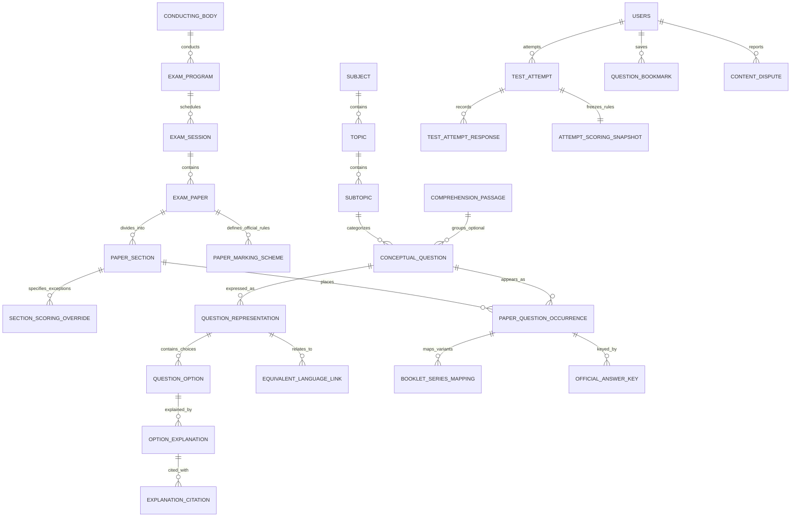

# MCQ Junction — Product Architecture, Domain Specification & Pre-Schema Gate Report

**Document Version:** 1.0.0 (Pre-Schema Baseline)  
**Date:** October 11, 2026  
**Status:** Approved for Schema Design  
**Target Platform:** Next.js 16 (App Router), React 19, TypeScript, Prisma ORM 7, Supabase PostgreSQL & Auth, Tailwind CSS 4, Vercel

---

## Executive Summary

**MCQ Junction** is an authentic, mobile-first learning and examination simulation platform for competitive exam aspirants in India. Starting with **Bihar School Teacher Examination (TRE) Computer Science**, MCQ Junction differentiates itself through three foundational pillars:
1. **Uncompromising Historical Provenance:** Preserving the original question text, script, typography, option ordering, and examination rules as presented in the physical examination hall. Zero silent machine-translation.
2. **Pedagogical Option Explanations:** Elevating previous-year questions from basic drills to active conceptual learning by explaining *why* distractors fail and *why* correct choices hold, substantiated by standard textbook citations.
3. **Rigorous Test Simulation & The Mistake Revision Loop:** Mirroring authentic historical paper structures, time constraints, section boundaries, and paper-specific marking schemes, followed by a 1-click mistake drill to turn test errors into permanent mastery.

---

## 1. Architectural & Product Decision Log

| ID | Domain | Prior Ambiguity / Risk | Formal Product Decision | Implementation & Architectural Boundary |
| :---: | :--- | :--- | :--- | :--- |
| **D-01** | **Bilingual & Multilingual Presentation** | Risk of autotranslation corrupting authentic exam wording or technical computer science terminology. | **Preserve exact original text, script, labels, and order.** Support English, Hindi, Urdu (RTL), Bangla. For MVP, implement a **1-tap language toggle** for equivalent representations on mobile. Side-by-side view supported where helpful, but not mandatory. | Original text is stored independently from any editorial translation. Urdu layout enforces `dir="rtl"` containers. Equivalent versions are linked via explicit verified relationships, never assumed by string similarity. |
| **D-02** | **Guest Access vs. User Accounts** | Uncertainty whether guests can attempt full timed mock tests and whether anonymous accounts should merge. | **Guests: Unrestricted access to Learning Mode** (browsing, filters, instant feedback, temporary browser state). **Signed-in users: Required for Test Mode**, persistent bookmarks, personal notes, and revision history. No complex guest-merging in MVP. | Learning Mode works without authentication headers. Test Mode entry checks server session (`getUser()`). Prevents database bloat from abandoned guest mock tests while providing an instant discovery funnel. |
| **D-03** | **Withdrawn Questions & Answer-Key Rulings** | Prior brief assumed all invalidated questions automatically receive full marks. | **Model official commission rulings explicitly per paper question.** Support: `FULL_MARKS_AWARDED`, `EXCLUDED_FROM_TOTAL`, and `CUSTOM_RULING`. Answer keys determine *accepted choices*; marking schemes determine *score calculation*. | Never silently rewrite historical scores when keys change. Re-evaluation must be an explicit, auditable, reproducible server operation. |
| **D-04** | **Booklet Series & Question Ordering** | Risk of either 4x database bloat from duplicating papers or assuming all sets are identical permutations. | **Standardize on Booklet Series 'A' as canonical for MVP content entry.** The conceptual model natively supports set identifiers (`B`, `C`, `D`), paper-specific sequence numbering, option re-ordering, and variant content. | MVP launches with Series 'A' without technical debt. Expanding to Series B/C/D in Phase 2 requires zero schema redesign or data migration. |
| **D-05** | **Prisma & Supabase Authorization Boundary** | Prisma connects as `postgres` (bypassing Supabase RLS), creating cross-tenant leakage vulnerability if RLS is assumed. | **Application-Layer Authorization Guard on all Server Actions.** Server verifies `auth.uid()` and queries `users.role` from PostgreSQL before executing mutations. DTO serializers strip keys/explanations from active tests. | Multi-layered defense: Strict server-side RBAC + DTO serialization + secondary Supabase RLS policies for direct database protection. |
| **D-06** | **Paper-Specific Marking Schemes** | Previous assumption used a single global `negative_marking_factor`. | **Capture original paper rules during upload:** correct marks, incorrect penalty, unattempted penalty, duration, section/question exceptions, and verification status. Allow students to choose **Original** or **Custom** scoring. | Stored as a first-class relational entity with section/question overrides. An **immutable scoring snapshot** is frozen into each `TestAttempt` at start time. |
| **D-07** | **Variable Question Option Counts** | Hardcoding 4 options or assuming D & E are always special options. | **Arbitrary option count ($N \ge 2$) supported natively.** Each option is an individual record with explicit label (`A`, `B`, `C`, `1`, `i`) and position index. Semantic meta-options explicitly flagged. | Supports 2-choice True/False, 4-choice standard, 5-choice BPSC historical, and 6-choice matching questions without schema changes. |

---

## 2. Revised Conceptual Data Model

### 2.1 Entity Relationship Diagram



### 2.2 Entity Specifications & Integrity Rules

#### 1. Examination & Taxonomy Layer
* **`ConductingBody`:** `id` (UUID), `code` (VARCHAR e.g. `'BPSC'`), `name` (TEXT), `state` (VARCHAR e.g. `'Bihar'`), `website_url` (TEXT).
* **`ExamProgram`:** `id` (UUID), `conducting_body_id` (FK), `code` (VARCHAR e.g. `'TRE'`), `name` (TEXT e.g. `'School Teacher Examination'`), `slug` (VARCHAR unique).
* **`ExamSession`:** `id` (UUID), `exam_program_id` (FK), `session_code` (VARCHAR e.g. `'TRE_3_0'`), `title` (TEXT e.g. `'TRE 3.0 — March 2024'`), `academic_year` (INT), `notification_reference` (TEXT).
* **`ExamPaper`:** `id` (UUID), `exam_session_id` (FK), `title` (TEXT e.g. `'Class 11-12 Computer Science'`), `shift_number` (INT), `exam_date` (DATE), `duration_minutes` (INT e.g. 150), `total_marks` (DECIMAL), `canonical_series` (VARCHAR default `'A'`).
* **`PaperSection`:** `id` (UUID), `exam_paper_id` (FK), `section_order` (INT), `title` (TEXT e.g. `'Part III: Computer Science'`), `is_qualifying` (BOOLEAN), `min_qualifying_marks` (DECIMAL nullable), `total_questions` (INT).
  * *Constraint:* `UNIQUE (exam_paper_id, section_order)`.

#### 2. Paper-Specific Marking Rules (Separation of Concerns)
* **`PaperMarkingScheme`:** `id` (UUID), `exam_paper_id` (FK unique), `marks_per_correct` (DECIMAL e.g. `1.00`), `penalty_per_incorrect` (DECIMAL e.g. `0.00` or `-0.33`), `penalty_per_unattempted` (DECIMAL e.g. `0.00` or `-0.33`), `multiple_correct_rule` (ENUM: `ALL_OR_NOTHING`, `PARTIAL_WITH_PENALTY`, `PARTIAL_WITHOUT_PENALTY`), `withdrawn_policy_default` (ENUM: `FULL_MARKS_AWARDED`, `EXCLUDED_FROM_TOTAL`, `RETAINED_ORIGINAL_KEY`), `rules_source_reference` (TEXT), `verification_status` (ENUM: `UNVERIFIED`, `EDITORIAL_VERIFIED`).
* **`SectionScoringOverride`:** `id` (UUID), `paper_section_id` (FK unique), `marks_per_correct` (DECIMAL nullable), `penalty_per_incorrect` (DECIMAL nullable), `penalty_per_unattempted` (DECIMAL nullable), `override_rationale` (TEXT).

#### 3. Core Academic Taxonomy, Questions & Script Representations
* **`Subject`:** `id` (UUID), `name` (VARCHAR), `slug` (VARCHAR unique).
* **`Topic`:** `id` (UUID), `subject_id` (FK), `name` (VARCHAR), `slug` (VARCHAR).
  * *Constraint:* `UNIQUE (subject_id, slug)`.
* **`Subtopic`:** `id` (UUID), `topic_id` (FK), `name` (VARCHAR), `slug` (VARCHAR).
  * *Constraint:* `UNIQUE (topic_id, slug)`.
* **`ComprehensionPassage`:** `id` (UUID), `language_code` (VARCHAR), `text_direction` (ENUM: `LTR`, `RTL`), `title` (TEXT nullable), `content_markdown` (TEXT), `source_reference` (TEXT nullable).
* **`ConceptualQuestion`:** `id` (UUID), `passage_id` (FK nullable), `subject_id` (FK), `topic_id` (FK), `subtopic_id` (FK nullable), `question_type` (ENUM: `SINGLE_CHOICE`, `MULTIPLE_CHOICE`, `ASSERTION_REASON`, `MATCH_FOLLOWING`, `NUMERICAL`), `difficulty` (ENUM: `EASY`, `MEDIUM`, `HARD`), `status` (ENUM: `DRAFT`, `IN_REVIEW`, `PUBLISHED`, `ARCHIVED`).
* **`QuestionRepresentation`:** `id` (UUID), `conceptual_question_id` (FK), `language_code` (VARCHAR e.g. `'en'`, `'hi'`, `'ur'`, `'bn'`), `text_direction` (ENUM: `LTR`, `RTL`), `prompt_markdown` (TEXT), `is_original_exam_text` (BOOLEAN default `true`), `provenance_notes` (TEXT nullable).
  * *Constraint:* `UNIQUE (conceptual_question_id, language_code, is_original_exam_text)`.
* **`QuestionOption`:** `id` (UUID), `representation_id` (FK), `position_index` (INT: 0 to $N-1$), `canonical_label` (VARCHAR e.g. `'A'`, `'B'`, `'C'`, `'D'`, `'E'`, `'1'`), `content_markdown` (TEXT), `is_meta_option` (BOOLEAN default `false` — `true` for BPSC Options D & E), `meta_option_type` (ENUM nullable: `NONE_OF_THE_ABOVE`, `MORE_THAN_ONE_OF_THE_ABOVE`, `ALL_OF_THE_ABOVE`, `CUSTOM`).
  * *Constraint:* `UNIQUE (representation_id, position_index)` and `UNIQUE (representation_id, canonical_label)`.

#### 4. Historical Occurrence, Booklet Mapping & Commission Keys
* **`PaperQuestionOccurrence`:** `id` (UUID), `exam_paper_id` (FK), `paper_section_id` (FK), `conceptual_question_id` (FK), `canonical_sequence_number` (INT: 1 to 150), `custom_marks_positive` (DECIMAL nullable), `custom_marks_negative` (DECIMAL nullable).
  * *Constraint:* `UNIQUE (exam_paper_id, canonical_sequence_number)` and `UNIQUE (exam_paper_id, conceptual_question_id)`.
* **`BookletSeriesMapping`:** `id` (UUID), `paper_question_occurrence_id` (FK), `series_code` (VARCHAR: `'B'`, `'C'`, `'D'`), `local_sequence_number` (INT), `option_order_permutation` (JSONB nullable e.g. `[2, 0, 1, 3]`), `variant_notes` (TEXT nullable).
  * *Constraint:* `UNIQUE (paper_question_occurrence_id, series_code)`.
* **`OfficialAnswerKey`:** `id` (UUID), `paper_question_occurrence_id` (FK), `key_version` (ENUM: `PROVISIONAL`, `SECOND_PROVISIONAL`, `FINAL_REVISED`), `key_status` (ENUM: `ACTIVE`, `SUPERSEDED`, `WITHDRAWN`), `accepted_labels` (TEXT[] e.g. `ARRAY['C']` or `ARRAY['B', 'D']`), `withdrawn_ruling` (ENUM nullable: `FULL_MARKS_AWARDED`, `EXCLUDED_FROM_TOTAL`, `CUSTOM_RULING`), `official_circular_ref` (TEXT nullable), `effective_from` (TIMESTAMPTZ).
  * *Constraint:* `UNIQUE (paper_question_occurrence_id, key_version)`.

#### 5. Option Explanations & Standard Citations
* **`OptionExplanation`:** `id` (UUID), `question_option_id` (FK), `language_code` (VARCHAR), `content_markdown` (TEXT), `verification_status` (ENUM: `DRAFT`, `COMMUNITY_VERIFIED`, `EDITORIAL_VERIFIED`, `DISPUTED`), `created_by_user_id` (FK to `users`), `verified_by_user_id` (FK to `users` nullable), `verified_at` (TIMESTAMPTZ nullable).
  * *Constraint:* `UNIQUE (question_option_id, language_code)`.
* **`ExplanationCitation`:** `id` (UUID), `option_explanation_id` (FK), `source_type` (ENUM: `TEXTBOOK`, `COMMISSION_KEY`, `GOVERNMENT_GAZETTE`, `ACADEMIC_STANDARD`), `publication_title` (TEXT), `author` (TEXT nullable), `edition` (VARCHAR nullable), `chapter_or_section` (TEXT nullable), `page_numbers` (VARCHAR nullable), `url` (TEXT nullable), `is_primary` (BOOLEAN default `true`).

#### 6. Student Practice, Test Attempts & Immutable Snapshots
* **`LearningAttemptLog`:** `id` (UUID), `user_id` (FK to `users` nullable for guest tracking), `conceptual_question_id` (FK), `selected_labels` (TEXT[]), `is_correct` (BOOLEAN), `time_spent_ms` (INT), `created_at` (TIMESTAMPTZ default now()).
* **`TestAttempt`:** `id` (UUID), `user_id` (FK to `users` NOT NULL), `exam_paper_id` (FK), `started_at` (TIMESTAMPTZ), `expires_at` (TIMESTAMPTZ), `submitted_at` (TIMESTAMPTZ nullable), `status` (ENUM: `IN_PROGRESS`, `SUBMITTED`, `EXPIRED`, `ABANDONED`), `total_score` (DECIMAL nullable), `total_correct` (INT nullable), `total_incorrect` (INT nullable), `total_unanswered` (INT nullable), `sectional_summary` (JSONB nullable), `idempotency_key` (VARCHAR unique nullable).
* **`AttemptScoringSnapshot`:** `id` (UUID), `test_attempt_id` (FK unique), `is_custom_scheme` (BOOLEAN), `marks_per_correct` (DECIMAL), `penalty_per_incorrect` (DECIMAL), `penalty_per_unattempted` (DECIMAL), `frozen_rules_json` (JSONB — contains full frozen tree of section overrides, question overrides, and withdrawn policies), `created_at` (TIMESTAMPTZ default now()).
* **`TestAttemptResponse`:** `id` (UUID), `test_attempt_id` (FK), `paper_question_occurrence_id` (FK), `selected_labels` (TEXT[]), `is_marked_for_review` (BOOLEAN default `false`), `time_spent_ms` (INT default 0), `evaluated_is_correct` (BOOLEAN nullable), `awarded_marks` (DECIMAL nullable), `updated_at` (TIMESTAMPTZ).
  * *Constraint:* `UNIQUE (test_attempt_id, paper_question_occurrence_id)`.
* **`QuestionBookmark`:** `id` (UUID), `user_id` (FK to `users`), `conceptual_question_id` (FK), `notes_markdown` (TEXT nullable), `created_at` (TIMESTAMPTZ).
  * *Constraint:* `UNIQUE (user_id, conceptual_question_id)`.
* **`ContentDispute`:** `id` (UUID), `user_id` (FK to `users`), `conceptual_question_id` (FK), `paper_question_occurrence_id` (FK nullable), `category` (ENUM: `WRONG_KEY`, `TYPO_SCRIPT`, `FLAWED_EXPLANATION`, `BROKEN_CITATION`), `comment` (TEXT), `status` (ENUM: `OPEN`, `UNDER_REVIEW`, `RESOLVED`, `REJECTED`), `resolution_notes` (TEXT nullable), `created_at` (TIMESTAMPTZ).

---

## 3. Ingestion & In-App User Experiences

### 3.1 Content Upload Workflow
1. **Paper Metadata & Official Scheme Entry:** Admin/Reviewer enters conducting body, exam name, shift, canonical booklet series, duration, and the verified marking rules (positive marks, negative marks, unattempted deductions, and official notification citation).
2. **Question Ingestion & Language Script Preservation:** Question prompt entered in authentic language script (English, Hindi, Urdu RTL, Bangla) with LaTeX mathematical expressions.
3. **Variable Option Ingestion:** Options assigned explicit labels (`A`, `B`, `C`...) and positions ($0, 1, \dots, N-1$). Meta-options (e.g. *“More than one”*, *“None of above”*) explicitly flagged.
4. **Answer Key & Citation Attachment:** The official answer key version attached with accepted option labels. Each option is provided with an explanation and verified textbook citation.
5. **Editorial Review Gate:** Content enters `DRAFT` $\rightarrow$ `IN_REVIEW` $\rightarrow$ `PUBLISHED`. Only `PUBLISHED` content renders in public practice and mock tests.

### 3.2 Pre-Test Selection Experience
Before a timed test begins, candidates select their scoring model:
* **Option A: Official Historical Examination Scheme [Verified]**
  * Displays the historical rules for that paper (e.g., TRE 3.0: $+1.00$ correct, $0.00$ incorrect, $0.00$ unattempted).
  * Sectional qualifying rules clearly highlighted.
* **Option B: Custom Practice Scheme**
  * Allows students to test their risk management under user-configured penalties (e.g., $+1.00$ correct, $-0.33$ incorrect, $-0.33$ unattempted).
  * Results are stamped with a `[Custom Practice Scheme]` badge.
* **Immutable Snapshot Generation:** Upon clicking "Start Test", the chosen rules are saved into `AttemptScoringSnapshot`.

---

## 4. Security, Authorization & Privacy Architecture

### 4.1 Prisma Connection & Supabase RLS Guard
* **Technical Reality:** Prisma connects using `DATABASE_URL` via `@prisma/adapter-pg` as the `postgres` user. In PostgreSQL, `postgres` possesses the `BYPASSRLS` attribute and bypasses RLS policies.
* **Application-Layer Authorization Guard:** All server actions and API routes must:
  1. Authenticate session using `supabase.auth.getUser()`.
  2. Verify user record and role from PostgreSQL (`prisma.user.findUnique()`).
  3. Validate tenant record ownership (`attempt.userId === session.user.id`).
  4. Return strictly sanitized Data Transfer Objects (DTOs).
* **Active Test Mode DTO Sanitization:** Active test payloads strictly omit `accepted_labels`, `OfficialAnswerKey`, `OptionExplanation`, and `ExplanationCitation`. Answers and explanations are transmitted only after final submission.

### 4.2 Role-Based Access Control (RBAC) Matrix

| Resource / Action | Anonymous Guest | STUDENT | CONTRIBUTOR | REVIEWER | ADMIN |
| :--- | :---: | :---: | :---: | :---: | :---: |
| **Browse Published Questions & Filters** | ✅ Read | ✅ Read | ✅ Read | ✅ Read | ✅ Full |
| **View Option Explanations in Practice** | ✅ Read | ✅ Read | ✅ Read | ✅ Read | ✅ Full |
| **Practice Learning Mode (Ephemeral)** | ✅ Local | ✅ Synced Log | ✅ Synced Log | ✅ Synced Log | ✅ Full |
| **Start Timed Test Attempt** | ❌ 401 Auth | ✅ Own Record | ✅ Own Record | ✅ Own Record | ✅ Full |
| **Autosave Question Selection** | ❌ 401 Auth | ✅ Own Attempt | ✅ Own Attempt | ✅ Own Attempt | ✅ Full |
| **Receive Active Test Payload** | ❌ 401 Auth | 🔒 Keys Stripped | 🔒 Keys Stripped | 🔒 Keys Stripped | 🔒 Keys Stripped |
| **Submit Test & Receive Scorecard** | ❌ 401 Auth | ✅ Own Attempt | ✅ Own Attempt | ✅ Own Attempt | ✅ Full |
| **Manage Bookmarks & Notes** | ❌ 401 Auth | ✅ Own Records | ✅ Own Records | ✅ Own Records | ✅ Full |
| **Submit Content Dispute Flag** | ❌ 401 Auth | ✅ Create | ✅ Create | ✅ Create | ✅ Full |
| **Draft Questions / Options / Citations**| ❌ 403 Forbidden| ❌ 403 Forbidden| ✅ Create/Edit Own| ✅ Create/Edit | ✅ Full |
| **Verify Content (`EDITORIAL_VERIFIED`)**| ❌ 403 Forbidden| ❌ 403 Forbidden| ❌ 403 Forbidden| ✅ Verify | ✅ Full |
| **Upload Paper & Official Marking Rules**| ❌ 403 Forbidden| ❌ 403 Forbidden| ❌ 403 Forbidden| ❌ 403 Forbidden| ✅ Full |
| **Publish / Supersede Answer Keys** | ❌ 403 Forbidden| ❌ 403 Forbidden| ❌ 403 Forbidden| ❌ 403 Forbidden| ✅ Full |
| **User Role Assignment & Revocation** | ❌ 403 Forbidden| ❌ 403 Forbidden| ❌ 403 Forbidden| ❌ 403 Forbidden| ✅ Full |

---

## 5. Concrete Acceptance Test Suite

### Group 1: Marking Schemes & Scoring Logic
* **`TEST-SCORE-01` (Zero-Penalty Scheme — BPSC TRE 1.0/2.0/3.0):**
  * *Setup:* 10 questions. Scheme: $+1.00$ Correct, $0.00$ Incorrect, $0.00$ Unattempted.
  * *Input:* 6 Correct, 3 Incorrect, 1 Unattempted.
  * *Result:* Score $= 6.00 / 10.00$. Zero penalties deducted.
* **`TEST-SCORE-02` (Dual-Penalty Scheme — Incorrect AND Unattempted Penalized):**
  * *Setup:* 10 questions. Scheme: $+1.00$ Correct, $-0.33$ Incorrect, $-0.33$ Unattempted.
  * *Input:* 6 Correct, 2 Incorrect, 2 Unattempted.
  * *Result:* Score $= (6 \times 1.00) - (2 \times 0.33) - (2 \times 0.33) = 4.68 / 10.00$.
* **`TEST-SCORE-03` (Section-Specific Scoring Override):**
  * *Setup:* Part I Language ($+1.00 / 0.00$), Part II GS ($+1.00 / -0.25$).
  * *Input:* Part I: 20 Correct, 10 Incorrect. Part II: 30 Correct, 10 Incorrect.
  * *Result:* Part I $= 20.00$, Part II $= 27.50$. Combined $= 47.50 / 70.00$.
* **`TEST-SCORE-04` (Custom Practice Scheme Execution):**
  * *Setup:* User configures $+2.00 / -0.50 / 0.00$ on an authentic TRE paper.
  * *Input:* 10 Correct, 5 Incorrect.
  * *Result:* Score $= 17.50$. Labeled as `[Custom Practice Scheme]`. Paper's official rules unchanged.
* **`TEST-SCORE-05` (Withdrawn Question Rulings):**
  * *Case A (`FULL_MARKS_AWARDED`):* Question invalidated. Full mark awarded to all candidates. Denominator remains $150$.
  * *Case B (`EXCLUDED_FROM_TOTAL`):* Question invalidated. Omitted from evaluation. Denominator adjusted to $149.00$.

### Group 2: Variable Options & Language Integrity
* **`TEST-OPT-01` (Variable Option Count Ingestion):**
  * *Assertion:* Questions with 2 (True/False), 4 (standard), 5 (BPSC), or 6 options ingest and serialize correctly.
* **`TEST-OPT-02` (BPSC Meta-Option Invariance):**
  * *Assertion:* Options D and E retain their explicit historical labels and position indices ($3$ and $4$) without accidental shuffling.
* **`TEST-LANG-01` (Urdu RTL Script Rendering):**
  * *Assertion:* Container renders with `dir="rtl"`, font `Noto Nastaliq Urdu`, and right-aligned option labels.

### Group 3: Security, Authorization & Historical Result Integrity
* **`TEST-SEC-01` (Zero Leakage in Active Test Payload):**
  * *Assertion:* Calling `getExamPaperForTest(paperId)` returns zero answer keys, accepted labels, or option explanation strings.
* **`TEST-SEC-02` (Cross-Tenant Attempt Access Rejection):**
  * *Assertion:* Student A cannot update or fetch Student B's test responses (403 Forbidden).
* **`TEST-SEC-03` (Historical Result Immutability):**
  * *Assertion:* When an administrator updates an answer key for Question #50, previously submitted attempts retain their original scores calculated under the historical frozen snapshot.

---

## 6. Phased Implementation Roadmap

```
+--------------------------------------------------------------------------------------------------+
| PHASE 1: BIHAR TRE COMPUTER SCIENCE MVP (Weeks 1 - 8)                                            |
| • Full authentic question bank for BPSC TRE 1.0, 2.0, 3.0 Computer Science (Class 11-12).        |
| • Variable 4-option and 5-option support (with fixed BPSC meta-options).                         |
| • Option-level explanations with primary textbook citations (NCERT, Korth, Galvin, CLRS).        |
| • Mobile-first Learning Mode with 1-tap language toggle and guest practice.                      |
| • Authentic 150-min Test Engine with Official vs Custom scoring selection.                       |
| • Resilient autosave (LocalStorage buffer + 5s debounced server sync).                           |
| • Server-authoritative scoring with frozen AttemptScoringSnapshot.                               |
| • 1-Click "Drill Mistakes" revision loop.                                                        |
+--------------------------------------------------------------------------------------------------+
                                                 |
                                                 v
+--------------------------------------------------------------------------------------------------+
| PHASE 2: BPSC CCE PRELIMS & ADVANCED FORMATS (Weeks 9 - 16)                                      |
| • BPSC Combined Competitive Examination (CCE) General Studies papers.                            |
| • Booklet Series B, C, D permutation mapping engine.                                             |
| • Comprehension / Passage-linked question runner (Part I Language).                              |
| • Topic Mastery Index (accuracy %, speed metrics, weak topic diagnosis).                         |
| • Editorial Discrepancy Review Queue & Audit Dashboard.                                          |
+--------------------------------------------------------------------------------------------------+
```

---

## 7. Implementation Readiness

### **VERDICT: READY FOR SCHEMA DESIGN**

### Justification:
1. All architectural decisions (D-01 through D-07) are approved and documented.
2. Conceptual entities, uniqueness constraints, and integrity rules are clearly specified.
3. Separation between paper rules, question occurrences, answer keys, custom configs, and test attempt snapshots is established.
4. Security boundaries for Prisma and Supabase RLS are defined.
5. Scope is strictly defined for the Bihar TRE Computer Science launch.

---
*Report compiled for the MCQ Junction Technical & Product Team.*
