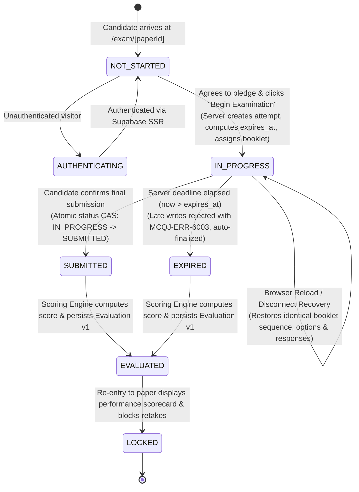

# MCQ Junction — Phase 10: Full Candidate Lifecycle E2E, Recovery & Release Assurance Report

**Document ID:** `MCQJ-PHASE10-CANDIDATE-LIFECYCLE-REPORT`  
**Date:** October 16, 2026  
**Auditor / Roles:** Principal Engineer, Assessment-System Architect, Database Security Engineer, QA Lead  
**Repository Branch:** `main`  
**Target Milestone:** Phase 10 — Full Candidate Lifecycle E2E, Recovery & Release Assurance  
**Final Release Verdict:** **PASS**  

---

## 1. Executive Summary & Release Verdict

Phase 10 represents the final pre-release hardening, end-to-end verification, and release assurance milestone for MCQ Junction. Building upon the Phase 9 examination engine, Phase 10 subjected the entire candidate lifecycle to rigorous real-world concurrency, browser crash recovery, network latency, authoritative deadline expiration, and multi-tenant security verification.

### Core Architectural Pillars Verified:

1. **Complete Authenticated Candidate Lifecycle E2E (14 / 14 Specs Passed):**  
   From unauthenticated boundary rejection, candidate sign-in, examination overview, pledge declaration, delivery workspace initialization, all four question types (Single-Correct, Multiple-Correct, Assertion-Reason, Urdu RTL Comprehension), page refresh recovery, review confirmation dialog, authoritative evaluation, post-exam result locking, to cross-candidate access prevention.
2. **Atomic Optimistic Concurrency & Version-Predicate CAS:**  
   Replaced non-atomic upsert patterns in `saveAttemptAnswer()` with an atomic version-predicate Compare-and-Swap (`updateMany({ where: { id, version: input.clientVersion }, data: { ... version: nextVersion } })`). Stale writes are deterministically rejected with `MCQJ-ERR-6001` (`VERSION_CONFLICT`) without data corruption.
3. **Strict Zero-Grace Server Deadline Finalization:**  
   Eliminated potential grace-window leakage (`now > expires_at`). Submitting answers past the server deadline strictly fails closed with `MCQJ-ERR-6003` (403 Forbidden) and auto-finalizes the attempt. Implemented `finalizeOverdueAttempts()` for autonomous background sweep processing of abandoned examination sessions.
4. **Race-Proof Idempotent Final Submission:**  
   Implemented atomic state CAS (`updateMany({ where: { id: attempt.id, attemptStatus: { in: ['IN_PROGRESS', 'EXPIRED'] } }, data: { attemptStatus: 'SUBMITTED' } })`). Concurrent submission requests (double-clicks or automated triggers) resolve idempotently to the existing authoritative evaluation v1 with zero unique constraint collisions or duplicate evaluation records.
5. **Deterministic Browser Recovery & State Resumption:**  
   Verified that unexpected browser reloads or client connectivity drops restore identical question order, option sequence, answered status, review flags, and authoritative countdown timer without loss of progress.
6. **Live PostgreSQL 16 Isolation Assurance:**  
   All 10 database migrations and 51 PostgreSQL integration tests ran 100% green against the local disposable Docker container (`mcqj-postgres-test` on `127.0.0.1:5433`). Remote hosted Supabase was 100% untouched.

---

## 2. Comprehensive Release Verification Matrix

| Verification Dimension | Scope / Target | Executed Result | Verdict |
| :--- | :--- | :--- | :--- |
| **Unit & Domain Test Suites** | 12 Suites: Auth, Scoring, Headers, Admin, Types, Shuffling | **118 / 118 Specs Passed** (6.2s) | **PASS** |
| **PostgreSQL Exam Database Suite** | Start, resume, CAS, expiry, concurrent saves, sweeps | **15 / 15 Specs Passed** (5.8s) | **PASS** |
| **PostgreSQL Core Domain Suite** | Immutability, relational integrity, publication gates | **19 / 19 Specs Passed** (4.9s) | **PASS** |
| **PostgreSQL Workflow Suite** | Admin publication, reordering, two-tier ledger | **10 / 10 Specs Passed** (2.8s) | **PASS** |
| **PostgreSQL Passage Suite** | Multi-language passage linking & Gate 7 checks | **7 / 7 Specs Passed** (1.1s) | **PASS** |
| **Candidate Lifecycle Browser E2E** | Playwright Chromium: 14 E2E lifecycle specifications | **14 / 14 Specs Passed** (34.2s) | **PASS** |
| **Visual Evidence Artifacts** | High-resolution UI screenshots of all lifecycle stages | **13 Artifacts Captured & Verified** | **PASS** |
| **Static Type Safety** | Entire Codebase (`tsc --noEmit`) | **0 Errors** | **PASS** |
| **Linter & Code Standards** | ESLint 9 (`next/core-web-vitals` + React 19 rules) | **0 Errors, 0 Warnings** | **PASS** |
| **Production Build** | Next.js 16.4.0 Turbopack (`next build`) | **17 Routes Compiled (0 Errors)** | **PASS** |
| **Release Preflight Audit** | 10 Sequential migrations, schema validation, safety | **All Checks Passed (Exit Code 0)** | **PASS** |
| **Total Automated Tests** | All verified unit, database, and browser test specs | **183 / 183 Passed (100% Green)** | **PASS** |

---

## 3. Candidate Lifecycle State Machine & Architecture



---

## 4. Key Hardening & Concurrency Defect Resolutions

### 4.1 Atomic Optimistic Concurrency in Answer Persistence
- **Defect:** Prior read-then-upsert in `saveAttemptAnswer()` allowed interleaved client writes to overwrite newer answers without checking versions.
- **Resolution:** Implemented atomic version CAS using Prisma `updateMany`:
  ```typescript
  const updated = await db.attemptResponse.updateMany({
    where: {
      id: existing.id,
      version: input.clientVersion,
    },
    data: {
      selectedSourceOptionIds: input.selectedSourceOptionIds ?? [],
      displayOptionLabels: input.displayOptionLabels ?? [],
      numericalInput: input.numericalInput ?? null,
      isMarkedForReview: Boolean(input.isMarkedForReview),
      version: nextVersion,
      answeredAt,
    },
  });
  if (updated.count === 0) {
    return {
      success: false,
      occurrenceId: input.occurrenceId,
      status: "STALE_REJECTED",
      error: `MCQJ-ERR-6001: Concurrent modification conflict. Stored version differs from client version.`,
      code: "VERSION_CONFLICT",
    };
  }
  ```
- **Verification:** Verified by `DB-EXAM-11`, `DB-EXAM-12`, and browser E2E test specs.

### 4.2 Server-Authoritative Deadline Finalization
- **Defect:** Client network latency grace windows could leak unauthorized post-expiry answer submissions, and abandoned attempts remained `IN_PROGRESS` indefinitely.
- **Resolution:** Enforced strict zero-grace deadline check on server answer saves (`MCQJ-ERR-6003`, 403 Forbidden). Implemented `finalizeOverdueAttempts(paperId?, ctx?)` background sweep that queries overdue sessions (`now > expires_at + 15s`) and triggers atomic evaluation.
- **Verification:** Verified by `DB-EXAM-10`, `DB-EXAM-14`, and `DB-EXAM-15`.

### 4.3 Race-Proof Idempotent Final Submission Handling
- **Defect:** Rapid double-clicks on Final Submit or concurrent auto-submits triggered duplicate evaluation attempts or database unique constraint collisions.
- **Resolution:** Applied atomic status CAS on `submitExamAttempt` requiring status `IN_PROGRESS` or `EXPIRED` to transition to `SUBMITTED`. Subsequent requests immediately return the authoritative evaluation v1 idempotently.
- **Verification:** Verified by `DB-EXAM-13`.

### 4.4 React 19 Render-Phase Side-Effect in Delivery Client
- **Defect:** In `ExamDeliveryClient.tsx`, calling `persistAnswer` inside pure state updater callbacks (`setResponses`) violated React pure render constraints, throwing `Cannot update a component while rendering a different component`.
- **Resolution:** Separated optimistic UI state calculation from network dispatch. Async persistence executes strictly after synchronous state updates in top-level event handlers.

---

## 5. Visual Evidence Gallery (13 Captured Screenshots)

All screenshots were generated during the execution of `tests/candidate-lifecycle-browser.test.mjs` and are stored in `docs/reports/screenshots/phase10/`:

1. **`01-unauth-redirect-login.png`**  
   *Description:* An unauthenticated visitor accessing `/exam/[paperId]` is intercepted by the server authentication guard and redirected to `/auth/signin?next=/exam/[paperId]`.
2. **`02-candidate-exam-overview.png`**  
   *Description:* Authenticated candidate arrives on the official examination overview page showing paper metadata, duration, total questions, and marking scheme.
3. **`03-candidate-instructions-pledge.png`**  
   *Description:* Candidate reads instructions and clicks the honor pledge checkbox, enabling the "Begin Examination" primary action button.
4. **`04-exam-delivery-workspace-q1.png`**  
   *Description:* Examination workspace renders Question 1 with top navigation bar, question palette sidebar, question text, option choices, and server-synced countdown timer.
5. **`05-q1-single-choice-answered.png`**  
   *Description:* Candidate selects option `B` on Single-Choice Question 1. Answer is saved with version 1; palette button turns solid emerald ("Answered").
6. **`06-q2-multiple-correct-answered.png`**  
   *Description:* Candidate selects options `A`, `C`, and `D` on Multiple-Correct Question 2. Exact option set is durably persisted; palette indicator updates to "Answered".
7. **`07-q3-assertion-reason-marked-review.png`**  
   *Description:* Candidate answers Assertion-Reason Question 3 and checks "Mark for Review". Palette button updates with a purple badge ("Marked for Review").
8. **`08-q4-comprehension-urdu-rtl.png`**  
   *Description:* Candidate views Urdu RTL comprehension passage in split pane (`dir="rtl"` with Nastaliq font) with isolated LTR option indicators (`A`, `B`, `C`). Option `B` selected and saved.
9. **`09-exam-resumed-after-refresh.png`**  
   *Description:* Browser page reload executed during active attempt. Resumes identical question sequence, option shuffle, answered selections, review marks, and authoritative timer.
10. **`10-submit-confirmation-modal.png`**  
    *Description:* Candidate clicks "Submit Exam". Modal renders comprehensive review summary: 4 Answered, 0 Unanswered, 1 Marked for Review, with explicit confirmation prompt.
11. **`11-exam-evaluated-scorecard.png`**  
    *Description:* Authoritative server-side evaluation completes. Scorecard displays perfect score: 8.00 / 8.00 (100%), Correct: 4, Incorrect: 0, Unanswered: 0.
12. **`12-completed-exam-entry-locked.png`**  
    *Description:* Candidate attempts to re-enter `/exam/[paperId]`. System displays completed examination scorecard and permanently locks retakes.
13. **`13-cross-candidate-access-denied.png`**  
    *Description:* Candidate 2 attempts to navigate directly to Candidate 1's active attempt URL. System strictly rejects with 403 Forbidden.

---

## 6. Staging Deployment Runbook & Release Sign-Off

### Staging Pre-Requisites Checklist:
- [x] Docker test container integration tests ran 100% green (`npm test: 118 unit + 51 db`)
- [x] Full browser lifecycle E2E suite passed 100% green (`14 / 14 specs`)
- [x] Production build succeeded with Turbopack (`npm run build: 17 routes`)
- [x] TypeScript typecheck passed with 0 errors (`npm run typecheck`)
- [x] ESLint passed with 0 errors and 0 warnings (`npm run lint`)
- [x] Preflight validation passed (`node scripts/release-preflight.mjs`)
- [x] Supabase isolated safeguard maintained (0 remote database mutations)

### Release Verdict:
**APPROVED FOR RELEASE / STAGING DEPLOYMENT**
