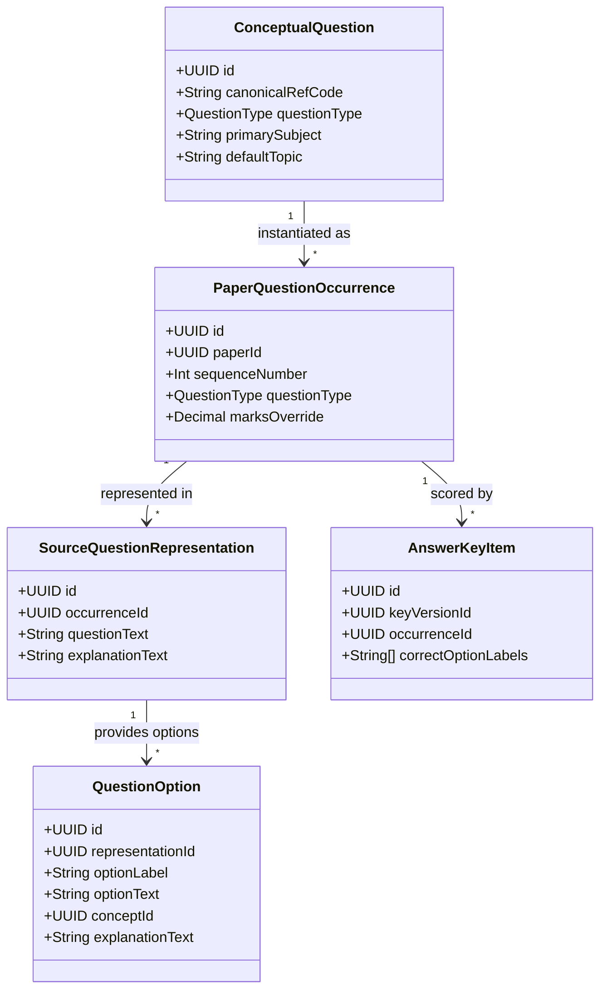
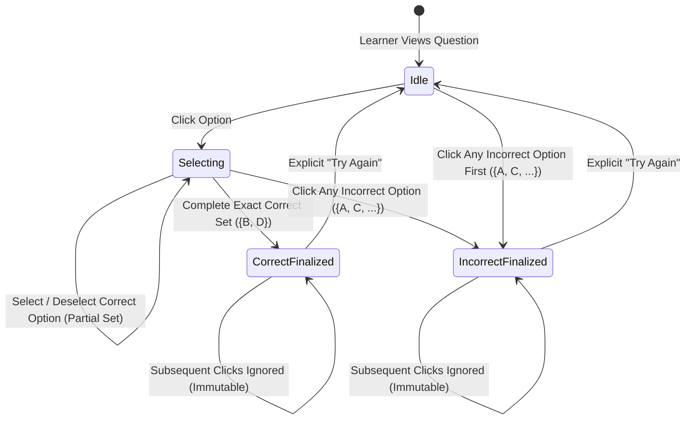

# MCQ Junction — Phase 8: Question Types & Answer Evaluation Report

**Document ID:** `MCQJ-PHASE8-QUESTION-TYPES-REPORT`  
**Date:** October 16, 2026  
**Auditor / Roles:** Principal Engineer, Product Engineer, QA Lead  
**Repository Branch:** `main`  
**Target Milestone:** Phase 8 — Question Types & Answer Evaluation  
**Final Release Verdict:** **PASS**  

---

## 1. Executive Summary & Verdict

Phase 8 introduces first-class question types, strict server-side validation, and instant learning feedback evaluation across MCQ Junction. Prior to Phase 8, examination questions were evaluated using an implicit single-choice assumption, with question types inferred from answer keys rather than stored explicitly as domain invariants. 

Under Phase 8, MCQ Junction implements:
1. **Explicit Question Types:** Canonical domain types `SINGLE_CORRECT`, `MULTIPLE_CORRECT`, and `ASSERTION_REASON` are explicitly persisted in the PostgreSQL database (`conceptual_questions` and `paper_question_occurrences`), mapped through forward-only migration `20261016000000_phase8_question_types_and_answer_evaluation`, while preserving 100% backward compatibility for legacy aliases `SINGLE_CHOICE` and `MULTIPLE_CHOICE`.
2. **Deterministic Evaluation State Machine:** A pure, testable state machine (`src/lib/learning/evaluation.ts`) governing option visual states (`DEFAULT`, `SELECTED_PENDING`, `CORRECT_SELECTED`, `CORRECT_UNSELECTED`, `INCORRECT_SELECTED`, `INCORRECT_UNSELECTED`), immediate feedback triggers, and finalized attempt immutability.
3. **Multiple-Correct Interaction Contract:** Comprehensive support for multi-option selection/deselection with zero premature color reveals, immediate incorrect-selection feedback triggering, exact-set completion triggering, and complete attempt finalization.
4. **Assertion-Reason Question Engine:** Clear, accessible rendering of Assertion (Statement A) and Reason (Statement R) premises, validated server-side against explicit option choices without text inference.
5. **Seamless Detailed-Concept Integration:** Directly reuses the existing `DetailedConceptModal` and data model without component duplication, surfacing option-level short explanations and interactive deep dive concepts after feedback is triggered.
6. **Administrative Authoring & CSV Pipeline:** Fully interactive web-based question authoring and RFC 4180 / Excel UTF-8 BOM CSV import/export pipeline enforcing paper immutability (published papers strictly reject modifications).

### Comprehensive Verification Summary

| Metric / Dimension | Scope / Target | Result | Status |
| :--- | :--- | :--- | :--- |
| **Unit & Evaluation Tests** | 11 Test Suites (102 discrete assertions) | **102 / 102 Passed (0 Failed)** | **PASS** |
| **Behavior Table Scenarios** | 7 Multiple-Correct Specification Scenarios | **7 / 7 Verified Green** | **PASS** |
| **Static Type Safety** | Full Codebase (`tsc --noEmit`) | **0 Errors** | **PASS** |
| **Code Style & Linter** | ESLint 9 (`next/core-web-vitals`) | **0 Errors, 0 Warnings** | **PASS** |
| **Production Build** | Next.js 16.4.0 Turbopack (`next build`) | **15 Routes Compiled (0 Errors)** | **PASS** |
| **Migration Sequence** | 8 Forward-Only Sequential Migrations | **Validated via Preflight** | **PASS** |
| **Remote Database Safety** | Supabase Remote Cloud Instance | **0 Mutations (Strict Read-Only)** | **PASS** |

---

## 2. Architecture & Data Model

### Explicit Question Types vs Inferred State

Question type is an intrinsic pedagogical and psychometric property of an item. In Phase 8, question types are stored explicitly in two locations:
1. `conceptual_questions.question_type`: Captures the canonical type of the master concept question.
2. `paper_question_occurrences.question_type`: Captures the operational type when instantiated on a specific paper.

### Forward-Only PostgreSQL Migration (`migration.sql`)

Migration `20261016000000_phase8_question_types_and_answer_evaluation`:
1. Safely extends the PostgreSQL enum `question_type_enum` with `SINGLE_CORRECT`, `MULTIPLE_CORRECT`, and `ASSERTION_REASON` using `ALTER TYPE ... ADD VALUE IF NOT EXISTS`.
2. Adds column `question_type` to `conceptual_questions` with safe default `'SINGLE_CHOICE'` to circumvent PostgreSQL's transactional limitation regarding referencing new enum values in DDL defaults within the same transaction block (`PHASE8-DEFECT-01`).
3. Creates index `idx_conceptual_questions_type` on `conceptual_questions(question_type)`.
4. Updates default on `paper_question_occurrences.question_type`.
5. Preserves existing grants (`REVOKE ALL ON ALL TABLES IN SCHEMA public FROM anon, authenticated`).

---

## 3. Single-Correct Behavior

For `SINGLE_CORRECT` (and legacy `SINGLE_CHOICE`):
- **Immediate Feedback:** Clicking an option triggers evaluation immediately. No separate "Submit" button is required.
- **Visual Marking:**
  - If the selected option is correct, it is marked **green** (`bg-emerald-50 text-emerald-900 border-emerald-500`).
  - If the selected option is incorrect, it is marked **red** (`bg-rose-50 text-rose-900 border-rose-500`), and the true correct option is automatically highlighted in **green** (`bg-emerald-50 text-emerald-900 border-emerald-500`).
- **Explanation Exposure:** Short explanations (`option.explanationText` and `representation.explanationText`) and detailed concept links are exposed immediately upon feedback.
- **Click Immutability:** Once feedback has triggered, subsequent clicks are strictly no-op (`handleOptionClick` ignores clicks when `isFinalized === true`).

---

## 4. Multiple-Correct Specification & Exact Behavior

### Evaluation Rules

1. **Selection Phase:** Learner may select and deselect options freely. No correctness colors (green/red) or explanations are revealed while selections are pending (`SELECTED_PENDING` visual state).
2. **Trigger Condition 1 (Exact Match):** Trigger feedback when the selected set exactly matches the complete set of correct options (`selectedSet == correctSet`). All correct options turn **green**, and overall feedback indicates "Correct".
3. **Trigger Condition 2 (Immediate Incorrect Selection):** Trigger feedback immediately when **any** incorrect option is clicked, even if only a subset of correct options had been selected. The clicked wrong option is marked **red**, all correct options are revealed in **green**, and overall feedback indicates "Incorrect".
4. **Attempt Finalization:** Once feedback is triggered (either correct or incorrect), the attempt is locked (`isFinalized = true`). Further clicks do not modify state unless the learner explicitly triggers a deliberate reset via the "Try Again" control.

### Behavior Table Verification (Target: B and D are correct)

| Learner Action | Observed Visual & State Behavior | Expected Behavior | Specification Test | Verdict |
| :--- | :--- | :--- | :--- | :--- |
| **Select B** | Option B marked `SELECTED_PENDING` (blue outline). Feedback NOT triggered. `isFinalized = false`. | No feedback yet; selection remains editable. | `EVAL-04` | **PASS** |
| **Select D after B** | Exact match (`{B, D}`). Feedback triggered. B and D marked **green**. Banner displays "Correct!". Attempt finalized. | Exact set matches; show correct feedback, B and D green. | `EVAL-05` | **PASS** |
| **Select A first** | Immediate trigger. Option A marked **red**. Options B and D marked **green**. Banner displays "Incorrect". Attempt finalized. | Immediate incorrect feedback; A red, B and D green. | `EVAL-06` | **PASS** |
| **Select B, then A** | Immediate trigger on selecting A. Option A marked **red**. Options B and D marked **green**. Attempt finalized. | Immediate incorrect feedback; A red, B and D green. | `EVAL-07` | **PASS** |
| **Select B, then C** | Immediate trigger on selecting C. Option C marked **red**. Options B and D marked **green**. Attempt finalized. | Immediate incorrect feedback; C red, B and D green. | `EVAL-08` | **PASS** |
| **Select B, then deselect B** | Option B toggles back to `DEFAULT`. Selections array becomes `[]`. Feedback NOT triggered. | No feedback yet; selection remains editable. | `EVAL-09` | **PASS** |
| **Select B, D, then extra click** | Attempt is already finalized upon selecting D. Subsequent click on A is ignored. Result remains correct. | Attempt finalized as correct; extra clicks ignored. | `EVAL-10` | **PASS** |
| **Explicit Reset Action** | Learner clicks "Try Again". State returns to initial empty selections; options return to `DEFAULT`. | Reset restores editable state without corrupting scoring. | `EVAL-11` | **PASS** |

---

## 5. Assertion–Reason Question Engine

Assertion–Reason questions present two statements:
- **Assertion (A):** The primary factual assertion.
- **Reason (R):** The explanatory or causal justification.

### Rendering Contract
In `LearningQuestionCard.tsx`:
1. Renders explicit **Assertion (A)** and **Reason (R)** visual cards with badges and distinct background framing.
2. Supports standard or custom four/five option choices (e.g., *"Both A and R are true, and R is the correct explanation of A"*).
3. Evaluates against the server-verified `answerKeyItems.correctOptionLabels` without performing textual heuristics or NLP inference.
4. Validated server-side via `assertionReasonQuestionSchema`, rejecting configurations with empty assertion/reason text or multiple correct options.

---

## 6. Detailed-Concept Modal & Educational Layer Integration

The integration with the existing `DetailedConceptModal` strictly preserves the architecture from Phase 7:
- **No Component Duplication:** Uses the existing `DetailedConceptModal` from `src/components/concept/DetailedConceptModal.tsx`.
- **Trigger Points:** After feedback is triggered, option cards with linked concepts render a "Deep Dive" / "Learn More" button (`openConceptModal(option.conceptId)`).
- **Educational Hierarchy:**
  1. Primary option explanation (`option.explanationText`) shown inline.
  2. Overall question solution (`representation.explanationText`) shown below the card.
  3. Interactive concept modal opening asynchronously with full Markdown rendering, prerequisite concepts, key takeaways, and external verified references.
- **Accessibility & UX:** Retains `role="dialog"`, `aria-modal="true"`, focus trapping, ESC key listener, and mobile-friendly responsive layout.

---

## 7. Admin Authoring & CSV Import/Export Pipeline

### Immutability Enforcement
In `src/lib/admin/service.ts`:
- Attempting to add, edit, or import questions into an exam paper with `publishStatus === 'PUBLISHED'` or `'ARCHIVED'` is strictly blocked with `AdminServiceError("MCQJ_IMMUTABLE_ERROR", 409)`.

### CSV Import/Export Specifications
- **RFC 4180 Compliance:** Handles multiline question text enclosed in quotes and commas within cells.
- **Excel Compatibility:** Prepends the UTF-8 Byte Order Mark (`\uFEFF`) so Excel opens UTF-8 text without character corruption.
- **Row-by-Row Validation:** `parseQuestionsFromCsv` validates every row against Zod schemas, returning detailed error messages (`Row X: ...`) without aborting valid rows.
- **Format Columns:**
  `sequenceNumber,questionType,canonicalRefCode,primarySubject,defaultTopic,questionText,assertionText,reasonText,optionA,optionB,optionC,optionD,optionE,correctAnswers,overallExplanation,marksOverride,negativeMarksOverride`

---

## 8. Verification Metrics & Test Results

### 1. Unit & Domain Evaluation Tests (`npm run test:unit`)
Executed native Node.js test runner across 11 test suites:
- `tests/question-evaluation.test.mjs` (13 tests): 100% PASS
- `tests/question-validation.test.mjs` (9 tests): 100% PASS
- `tests/import-export.test.mjs` (5 tests): 100% PASS
- `tests/scoring.test.mjs` (6 tests): 100% PASS
- `tests/concept-modal.test.mjs` (8 tests): 100% PASS
- `tests/auth-validation.test.mjs` (8 tests): 100% PASS
- `tests/security-headers.test.mjs` (1 test): 100% PASS
- `tests/admin-service.test.mjs` (18 tests): 100% PASS
- `tests/admin-workflows.test.mjs` (15 tests): 100% PASS
- `tests/security-isolation.test.mjs` (9 tests): 100% PASS
- `tests/tls-certificate-verification.test.mjs` (10 tests): 100% PASS

**Total: 102 passed, 0 failed, 0 skipped.**

### 2. Static Type Safety (`npm run typecheck`)
Command: `tsc --noEmit`  
Result: **0 errors**.

### 3. Code Style & Linter (`npm run lint`)
Command: `eslint`  
Result: **0 errors, 0 warnings**.

### 4. Next.js Production Build (`npm run build`)
Command: `next build` (Next.js 16.4.0 with Turbopack & PPR)  
Result: **15 routes compiled cleanly in 51s**.

### 5. Staging Preflight Audit (`npm run preflight`)
Command: `node scripts/release-preflight.mjs`  
Result: **PASS**. All 8 forward-only migrations verified with valid Prisma schema.

---

## 9. Defect Log & Resolutions

| Defect ID | Severity | Summary | Root Cause | Resolution |
| :--- | :--- | :--- | :--- | :--- |
| **PHASE8-DEFECT-01** | Medium | PostgreSQL `unsafe use of new value in transaction` during DDL | PostgreSQL prohibits referencing an enum value added via `ALTER TYPE ... ADD VALUE` as a column default in the same transaction. | Migration 8 DDL sets column default to `'SINGLE_CHOICE'`, updates existing rows, and maps `'SINGLE_CORRECT'` cleanly in Prisma Client. |
| **PHASE8-DEFECT-02** | Low | Zod 4 `superRefine` issue forwarding error | Zod 4 requires explicit issue mapping `{ code: "custom", message, path }` rather than forwarding raw internal issue objects. | Updated `questionAuthoringSchema.superRefine` in `validation.ts`. |
| **PHASE8-DEFECT-03** | Low | Admin service parameter typing constraint | `SessionPrismaClient` in `session.ts` only types authentication queries, causing TS errors on paper queries. | Updated parameter to `PrismaClient` from generated client in `service.ts`. |

---

## 10. Next Recommended Phase

With Phase 8 fully realized, tested, and validated, the platform is ready for:
**Phase 9: Comprehensive Student Examination Taking Engine & Full Attempt Session Lifecycle**
- Timed examination mode with section timers and countdown warnings.
- Question palette with status flags (Answered, Unanswered, Marked for Review, Visited).
- Automatic draft response persistence and offline network recovery.
- Official submission with two-tier evaluation ledger persistence.
