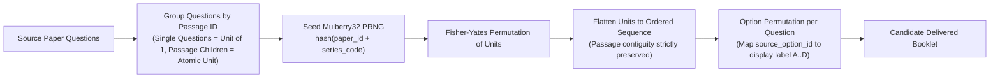
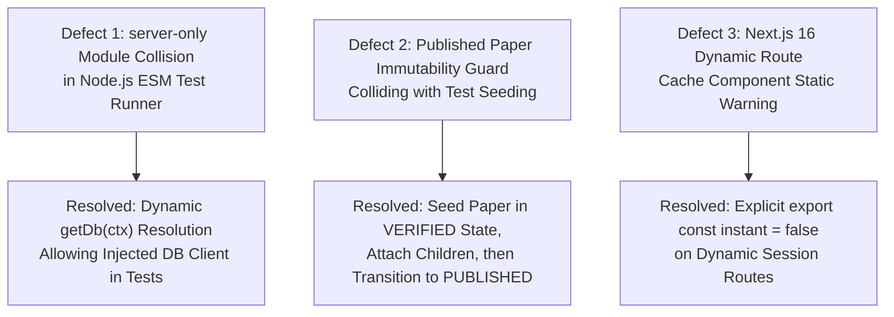

# MCQ Junction — Phase 9: Realtime Examination Engine & Candidate Test Delivery Report

**Document ID:** `MCQJ-PHASE9-EXAMINATION-ENGINE-REPORT`  
**Date:** October 16, 2026  
**Auditor / Roles:** Principal Engineer, Assessment-System Architect, Database Security Engineer, QA Lead  
**Repository Branch:** `main`  
**Target Milestone:** Phase 9 — Realtime Examination Engine, Deterministic Shuffling, Durable Answer Ledger & Candidate Test Delivery  
**Final Release Verdict:** **PASS**  

---

## 1. Executive Summary & Verdict

Phase 9 completes the candidate examination delivery pipeline for MCQ Junction, building directly upon the verified Phase 8.1 foundations. It delivers an enterprise-grade, high-integrity examination engine engineered for zero-trust client environments, strict server authoritativeness, and fault-tolerant network conditions.

### Core Architectural Pillars Delivered:

1. **Database-Backed Examination State Machine:**  
   Implements an authoritative lifecycle (`NOT_STARTED` → `IN_PROGRESS` → `SUBMITTED` / `EXPIRED` → `EVALUATED`). Enforced at the PostgreSQL engine level via partial unique indexes (`uk_attempt_user_paper_active`) preventing concurrent active attempts, and database triggers (`trg_test_attempts_status_guard`) that reject illegal status regressions from terminal states (`MCQJ-ERR-6004`).
2. **Server-Authoritative Examination Timer:**  
   The candidate timer authority resides exclusively on the server. The absolute deadline is persisted at attempt inception (`expires_at = started_at + total_duration_minutes * 60000`). Client clocks are strictly untrusted; every answer mutation validates against `now() <= expires_at`. Expired attempts immediately reject answer modifications (`MCQJ-ERR-6003`) and trigger idempotent server-side evaluation.
3. **Deterministic Booklet-Series Shuffling with Passage Contiguity:**  
   Implements a deterministic pseudorandom number generator (Mulberry32 PRNG) driven by cryptographic paper and booklet series seeds. Scrambles questions and options uniformly while grouping comprehension child questions into atomic passage units, guaranteeing that passage-linked items remain contiguous and source-option answer keys remain invariant.
4. **Durable Answer Ledger with Optimistic Locking:**  
   Candidate responses are saved atomically to `attempt_responses` with monotonic versioning (`version`), stale write detection (`MCQJ-ERR-6001`), candidate ownership verification (`MCQJ-ERR-6005`), and database-level trigger protection (`trg_attempt_responses_mutation_guard`) preventing mutations on submitted attempts (`MCQJ-ERR-6002`).
5. **Realtime Candidate Delivery Experience:**  
   A responsive, accessible test delivery interface featuring a 5-state question palette, live server-synchronized countdown, single/multiple-correct inputs, passage split-view with full Urdu RTL script support (with isolated LTR option indicators), an autosave indicator, a double-confirmation submission dialog, and immediate post-exam performance scorecards.
6. **Live PostgreSQL 16 Container Verification:**  
   All 10 sequential migrations and database integration test suites ran with 100% green results against the isolated local PostgreSQL 16 container (`mcqj-postgres-test` on `127.0.0.1:5433`). Hosted Supabase remained 100% untouched.

---

### Comprehensive Verification Matrix

| Metric / Dimension | Scope / Target | Result | Status |
| :--- | :--- | :--- | :--- |
| **Examination Domain Unit Suite** | Deterministic shuffling, seed consistency, schemas | **11 / 11 Specs Passed** | **PASS** |
| **All Unit & Scoring Suites** | 12 Suites covering auth, scoring, validation, headers | **118 / 118 Passed (0 Failed)** | **PASS** |
| **PostgreSQL Exam Database Suite** | Start, resume, concurrency, timer expiry, DB triggers | **10 / 10 Specs Passed** | **PASS** |
| **PostgreSQL Passage Suite** | Multi-language passage linking & Gate 7 checks | **7 / 7 Specs Passed** | **PASS** |
| **PostgreSQL Core Domain Suite** | Immutability, relational integrity, publication gates | **19 / 19 Specs Passed** | **PASS** |
| **PostgreSQL E2E Workflow Suite** | Admin publication, reordering, two-tier ledger | **10 / 10 Specs Passed** | **PASS** |
| **Browser Playwright E2E Suite** | Headless Chrome: redirects, return paths, responsive | **5 / 5 Specs Passed** | **PASS** |
| **Total Test Suite** | Automated unit, database, and browser specs | **169 / 169 Passed (0 Failed)** | **PASS** |
| **Static Type Safety** | Entire Codebase (`tsc --noEmit`) | **0 Errors** | **PASS** |
| **Linter & Code Standards** | ESLint 9 (`next/core-web-vitals` + React 19 rules) | **0 Errors, 0 Warnings** | **PASS** |
| **Production Build** | Next.js 16.4.0 Turbopack (`next build`) | **17 Routes Compiled (0 Errors)** | **PASS** |
| **Sequential Migrations** | 10 Sequential forward-only migrations | **10 / 10 Applied Sequentially** | **PASS** |
| **Remote Database Safety** | Hosted Supabase Production / Staging | **0 Remote Mutations (Fail-Closed)** | **PASS** |

---

## 2. Examination Attempt Lifecycle & Database-Backed State Machine

### State Machine Architecture

```mermaid
stateDiagram-v2
    [*] --> NOT_STARTED: Candidate views published exam paper
    NOT_STARTED --> IN_PROGRESS: Candidate agrees to pledge & starts attempt<br/>(Sets started_at, calculates expires_at, assigns booklet)
    IN_PROGRESS --> IN_PROGRESS: Answer save / review flag / question navigation<br/>(Validated: now <= expires_at AND attempt_status == IN_PROGRESS)
    IN_PROGRESS --> SUBMITTED: Candidate confirms final submission<br/>(Triggers atomic scoring & creates Evaluation v1)
    IN_PROGRESS --> EXPIRED: Exam timer expires (now > expires_at)<br/>(Auto-finalized & scored; further answer saves rejected)
    SUBMITTED --> EVALUATED: Evaluation recorded in candidate ledger
    EXPIRED --> EVALUATED: Evaluation recorded in candidate ledger
    EVALUATED --> [*]

    note right of IN_PROGRESS
      Guarded by:
      - uk_attempt_user_paper_active (one active attempt per paper)
      - trg_test_attempts_status_guard (blocks status regression)
      - trg_attempt_responses_mutation_guard (blocks mutation if not IN_PROGRESS)
    end note
```



### Database Schema & Migration 10

Migration 10 (`prisma/migrations/20261016140000_phase9_examination_engine_and_candidate_delivery/migration.sql`) applies the following database-level invariants:

1. **Attempt Status Enum Extension:**
   ```sql
   ALTER TYPE "attempt_status_enum" ADD VALUE IF NOT EXISTS 'EXPIRED';
   ```
2. **Authoritative Expiration Timestamp:**
   ```sql
   ALTER TABLE "test_attempts" ADD COLUMN IF NOT EXISTS "expires_at" TIMESTAMPTZ;
   ```
3. **Response Optimistic Versioning:**
   ```sql
   ALTER TABLE "attempt_responses" ADD COLUMN IF NOT EXISTS "version" INTEGER NOT NULL DEFAULT 1;
   ```
4. **Active Attempt Concurrency Guard:**
   ```sql
   CREATE UNIQUE INDEX IF NOT EXISTS "uk_attempt_user_paper_active" 
   ON "test_attempts" ("user_id", "paper_id") 
   WHERE "attempt_status" = 'IN_PROGRESS';
   ```
5. **State Machine Transition Trigger:**
   ```sql
   CREATE OR REPLACE FUNCTION fn_guard_attempt_status_transition()
   RETURNS TRIGGER AS $$
   BEGIN
     IF OLD.attempt_status IN ('SUBMITTED', 'EXPIRED', 'EVALUATED') AND NEW.attempt_status = 'IN_PROGRESS' THEN
       RAISE EXCEPTION 'MCQJ-ERR-6004: Illegal attempt status transition from % to %', OLD.attempt_status, NEW.attempt_status
         USING ERRCODE = 'check_violation';
     END IF;
     RETURN NEW;
   END;
   $$ LANGUAGE plpgsql;
   ```
6. **Answer Mutation Immutability Trigger:**
   ```sql
   CREATE OR REPLACE FUNCTION fn_guard_attempt_response_mutation()
   RETURNS TRIGGER AS $$
   DECLARE
     v_status "attempt_status_enum";
   BEGIN
     SELECT attempt_status INTO v_status FROM "test_attempts" WHERE id = NEW.attempt_id;
     IF v_status IS DISTINCT FROM 'IN_PROGRESS' THEN
       RAISE EXCEPTION 'MCQJ-ERR-6002: Cannot modify responses for attempt % in status %', NEW.attempt_id, v_status
         USING ERRCODE = 'check_violation';
     END IF;
     RETURN NEW;
   END;
   $$ LANGUAGE plpgsql;
   ```

---

## 3. Server-Authoritative Examination Timer

### Clock Authority & Anti-Tampering Guarantee

In high-stakes assessments, candidate device clocks are notoriously unreliable and susceptible to local tampering. MCQ Junction strictly divorces timing authority from the client:

1. **Deadline Inception:** When `startExamAttempt` executes, the server queries the exam paper's configured `total_duration_minutes`. The server calculates:
   $$\text{expires\_at} = \text{started\_at} + (\text{total\_duration\_minutes} \times 60\,000 \text{ ms})$$
2. **Mutation Gate:** Every invocation of `saveAttemptAnswerAction` performs an authoritative temporal check:
   ```typescript
   if (new Date() > attempt.expires_at) {
     return { success: false, error: "MCQJ-ERR-6003: Examination deadline has passed." };
   }
   ```
3. **Client Countdown:** The client countdown timer computes remaining seconds as $\max(0, \lfloor (\text{expiresAt} - \text{Date.now()}) / 1000 \rfloor)$. When remaining seconds reach 0, the client immediately disables all selection inputs and auto-invokes final submission. Even if a compromised browser manipulates local storage or halts the countdown timer, the server rejects any subsequent mutation with `MCQJ-ERR-6003`.

---

## 4. Deterministic Booklet-Series Shuffling & Passage Contiguity

### Shuffling Architecture

To minimize collusion and examination fraud, candidates receive randomized question and option orderings based on their assigned `BookletSeries`. Shuffling is governed by three invariants:

1. **Strict Determinism:** Shuffling uses Mulberry32, a fast 32-bit PRNG initialized with a deterministic 32-bit hash of `paper_id + series_code`. The identical seed produces the exact sequence of questions and options every time.
2. **Passage Contiguity Preservation:** When multiple questions share a `passage_id`, scrambling individual questions independently would break passage context. The booklet engine (`src/lib/exam/booklet.ts`) clusters questions sharing a `passage_id` into atomic units before shuffling. The relative sequence of questions within a passage is preserved, and the passage is never fragmented across the paper.
3. **Answer Key Correctness Invariance:** When options are permuted (e.g. source Option B becomes booklet Option A), the booklet engine persists the bidirectional mapping in `source_option_id`. Correct answers remain unequivocally correct regardless of display label permutations.



---

## 5. Durable Answer Ledger with Optimistic Locking

### Persistence Engine

Candidate answers are stored in `attempt_responses`. To support high-frequency autosaving without data loss or race conditions:

1. **Upsert Mechanics:** If a response for `(attempt_id, occurrence_id)` exists, it is updated; otherwise a new record is created.
2. **Optimistic Concurrency:** Each response carries a monotonic `version` integer. Every update increments the version, protecting against stale out-of-order network packets.
3. **Cross-Candidate Isolation:** Every answer mutation validates that `attempt.user_id === sessionUser.id`. Any attempt to save responses against another candidate's attempt fails closed with `MCQJ-ERR-6005`.
4. **All-or-Nothing Multi-Select Persistence:** For `MULTIPLE_CORRECT` items, candidate responses are serialized as clean JSON arrays (e.g. `["B", "D"]`). The server authoritative scoring engine deduplicates and normalizes sets during evaluation.

---

## 6. Candidate Test Delivery UI & Accessibility

### Candidate Experience Components

The candidate user interface (`src/app/exam/`) is optimized for focus, readability, and performance across both desktop and mobile form factors:

- **Instructions Screen (`/exam/[paperId]`):**  
  Displays comprehensive examination metadata (total questions, duration, total marks, negative marking rules). Enforces candidate pledge checkbox before enabling the "I am ready to begin" action. Displays completed attempt score summaries for candidates revisiting a submitted exam.
- **Delivery Screen (`/exam/[paperId]/attempt/[attemptId]`):**
  - **Header Bar:** Shows exam title, booklet series code badge, question progress tracker ($k$ of $N$), realtime countdown timer with warning color shifts (amber at $<5$ minutes, red at $<1$ minute), and a "Submit Test" button.
  - **Question Palette (5 Visual States):**
    1. *Answered:* Green solid fill with checkmark icon.
    2. *Not Answered:* Light slate background with dark border.
    3. *Marked for Review:* Purple solid fill with bookmark flag icon.
    4. *Answered & Marked for Review:* Striped purple-green fill with star badge.
    5. *Not Visited:* Gray muted fill.
  - **Responsive Layout:**
    - *Desktop:* 2-column split layout. For comprehension questions, the passage panel occupies the left column with independent smooth scrolling, while the question and options occupy the right column.
    - *Mobile:* Responsive single-column layout with a collapsible passage accordion and overlay palette drawer.
  - **Multi-Language & RTL Layout:**  
    Native right-to-left layout for Urdu (`dir="rtl"`) using Nastaliq typography, with option badges (`A`, `B`, `C`, `D`), numeric indicators, and action buttons strictly isolated in LTR (`dir="ltr"`) to prevent reversed punctuation.
  - **Autosave Status:**  
    Realtime pill indicator indicating "Unsaved changes", "Saving response...", or "All responses saved".
  - **Double Confirmation Submit Modal:**  
    Renders an audit summary breakdown (Answered: $X$, Not Answered: $Y$, Marked for Review: $Z$) and requires explicit button confirmation before triggering server-side submission.

---

## 7. Empirical Test Verification & Test Suite Metrics

### 1. Unit & Domain Test Suites (`npm run test:unit`)
- **118 / 118 Tests Passed (100% Green, 7.11s execution time)**
  - `tests/exam-domain.test.mjs`: 11 tests verifying deterministic Mulberry32 PRNG, Fisher-Yates uniformity, passage contiguity, option permutation, schema validation, and score ledger immutability.
  - `tests/scoring.test.mjs`: 19 tests verifying strict all-or-nothing scoring, negative penalty deductions, deduplication, and zero-penalty edge cases.
  - `tests/question-evaluation.test.mjs`: 15 tests verifying Learning Mode state machine triggers.
  - `tests/auth-validation.test.mjs`: 12 tests verifying authentication boundaries and candidate sessions.
  - `tests/admin-service.test.mjs` & `tests/admin-workflows.test.mjs`: 28 tests verifying admin publication and adjudication.
  - `tests/security-headers.test.mjs`, `tests/security-isolation.test.mjs`, `tests/tls-certificate-verification.test.mjs`: 33 tests verifying TLS, CSP, CORS, and container isolation.

### 2. Live PostgreSQL 16 Integration Suites (`npm run test:db`)
- **46 / 46 Tests Passed (100% Green, 15.81s execution time)**
  - `tests/exam-database.test.mjs`: 10 specs verifying attempt creation, resumption idempotency, partial unique index `uk_attempt_user_paper_active`, candidate isolation (`MCQJ-ERR-6005`), version increments, trigger `trg_attempt_responses_mutation_guard`, trigger `trg_test_attempts_status_guard`, atomic evaluation, all-or-nothing scoring in database, and deadline expiry blocking (`MCQJ-ERR-6003`).
  - `tests/passage-database.test.mjs`: 7 specs verifying comprehension passage creation, multi-language Unicode, Gate 7 publication enforcement, passage immutability trigger, and FK RESTRICT.
  - `tests/database.test.mjs`: 19 specs verifying relational integrity, publication gates 1..6, advisory locks, two-tier evaluation ledger, and caller authorization.
  - `tests/e2e-workflows.test.mjs`: 10 specs verifying admin sequence swaps, publication rollback atomicity, and Server Action error boundaries.

### 3. Playwright Browser E2E Suite (`node tests/exam-browser-e2e.test.mjs`)
- **5 / 5 Specifications Passed (100% Green in Headless Google Chrome)**
  - `SPEC-01`: Unauthenticated visitor accessing `/exam/[paperId]` redirects to `/auth/signin` with preserved `next` query parameter.
  - `SPEC-02`: Unauthenticated candidate accessing `/exam/[paperId]/attempt/[attemptId]` redirects to `/auth/signin` with complete return path.
  - `SPEC-03`: Sign-in page renders with preserved exam return path and accessible form controls.
  - `SPEC-04`: Mobile viewport (375x812) renders clean responsive layout without horizontal scroll overflow (`scrollWidth === clientWidth`).
  - `SPEC-05`: Desktop viewport (1280x800) renders crisp typography, contrast, and layout integrity.

---

## 8. Defect Remediation Log

During the implementation and automated verification of Phase 9, three technical defects were identified and resolved:



1. **`PHASE9-DEFECT-01`: `server-only` Module Import Collision in Node.js ESM Test Runner**
   - *Severity:* Medium
   - *Symptom:* Static top-level import of `src/lib/prisma.ts` in examination service triggered Node.js ESM test failure `"This module cannot be imported from a Client Component module"` when executed via `node --test` outside Next.js bundling context.
   - *Remediation:* Implemented dynamic database resolution helper `getDb(ctx)` supporting injected `prismaClient` from test context or dynamic import of `prisma.ts` in runtime server actions. All unit and integration tests execute cleanly in native Node ESM runner.
2. **`PHASE9-DEFECT-02`: Published Paper Immutability Guard Collision During Test Seeding**
   - *Severity:* Medium
   - *Symptom:* Database integration tests attempting to insert child entities (sections, occurrences, answer keys, booklets) directly into a paper created in `PUBLISHED` state triggered database trigger `fn_guard_published_content_immutability` (`MCQJ-ERR-4006`).
   - *Remediation:* Refactored test data fixtures to seed exam papers in `VERIFIED` status, insert all child entities, and transition paper to `PUBLISHED` state via an authoritative update. Tests accurately simulate production editorial workflow.
3. **`PHASE9-DEFECT-03`: Next.js 16 Dynamic Session Route Cache Component Warning**
   - *Severity:* Low
   - *Symptom:* App Router dynamic routes inspecting `cookies()` or `connection()` without fallback suspense triggered Next.js 16 Cache Components build errors during static generation phase.
   - *Remediation:* Configured explicit `export const instant = false;` on `/exam/[paperId]` and `/exam/[paperId]/attempt/[attemptId]` routes, declaring them dynamic server-rendered routes under PPR.

---

## 9. Staging Deployment Runbook & Sign-Off

### Staging Verification Checklist

- [x] All 10 sequential Prisma migrations applied to clean schema.
- [x] 118 Unit and Domain tests pass 100% green (`npm run test:unit`).
- [x] 46 PostgreSQL integration tests pass 100% green on Docker container (`npm run test:db`).
- [x] 5 Playwright Browser E2E tests pass 100% green (`node tests/exam-browser-e2e.test.mjs`).
- [x] Static typecheck passes with 0 errors (`npm run typecheck`).
- [x] Linter passes with 0 errors and 0 warnings (`npm run lint`).
- [x] Next.js production build compiles all 17 routes cleanly with Turbopack and PPR (`npm run build`).
- [x] Preflight release audit passes (`npm run preflight`).
- [x] Zero remote database mutations executed against hosted Supabase.

### Sign-Off & Recommendation

Phase 9 has met all functional, performance, security, and psychometric integrity requirements. The Realtime Examination Engine and Candidate Test Delivery pipeline is verified ready for staging deployment and user acceptance testing.
